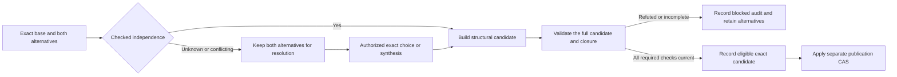

# RT-24 independent merge, retained conflicts and exact validation audit

A structural merge candidate can combine changes into a graph that neither parent contained. It needs a current proof of independence or an authorized exact resolution, then complete validation of the result. This candidate defines the automatic and interactive routes and checks their audit identity. It joins the scoped merge, source coverage and exact replay evidence without changing those historical records.

## Independence and conservative handling

Use a checked model of read, write, scope and observation dependencies to establish that each change leaves the other's inputs and permitted observations intact. Read/write disjointness is sufficient under the finite checked model only when the footprints, extraction and effect rules are complete. A proof that edit order commutes does not discharge a shared quota, type or contract constraint on the combined result. Lease, foreign effects, metadata policy and forward/reverse graph closure each matter where the verified scope consumes them.

When the evidence cannot establish independent composition, retain both exact alternatives with their original base, typed conflict reason and proof gaps. Expose those alternatives to a resolution tool. It may present a choice of ours, theirs or an explicit newly constructed result. A resolution request binds the chosen exact inputs, candidate, policy, resolver authority and current context. Changing the current context invalidates the prior choice. Missing context stays pending. An identified joint violation remains invalid. Resolve no conflict by silently discarding a parent or flattening its differing bound facts.



The [independence study](RT-24-INDEPENDENT-MERGE-GATE-2026-11-25.md) checks 3,888 finite patch/state cases. All 1,458 admitted compositions commute, yet 24 violate a combined capacity invariant. The [conservative comparison](RT-24-CONSERVATIVE-MERGE-2026-11-25.md) keeps exact alternatives and separates eleven scoped decisions. Missing or stale evidence remains pending. The [resolution study](RT-24-SAFE-MERGE-RESOLUTION-BOUNDARY-2026-11-25.md) connects applicable decisions to explicit scope and retained candidate data.

## Post-merge validation and reproducibility

Validate graph content and root integrity, typed declarations, contract/provider conformance, source and dependency completeness, required tests and required proofs. Each record must bind exact candidate, scope, tool, policy and relevant assumptions. Record unknown, unavailable and failed dispositions. A partially checked graph can remain reviewable without being eligible for publication. A complete candidate still needs fresh expected state and explicit publication authority before updating any Git or semantic selection.

Record ordered base/ours/theirs pins, proposed and selected candidate, conflict classifications, exact resolution, policy and every required validation finding. A replay checks that exact record as well as the semantic candidate. Reordering independent receipt entries can use canonical serialization. Reordering parent roles, changing policy, or dropping a failure changes the audit. The [merge coverage study](RT-24-MERGE-ADMISSION-COVERAGE-2026-11-25.md) admits only one of 165 integrated source and reverse-edge cases. The [audit replay study](RT-24-MERGE-VALIDATION-AUDIT-REPLAY-2026-11-25.md) reproduces the graph in all eleven cases and exact audit in only three, including a blocked case.

## Checked composition

The finite model crosses independence available or unavailable, four resolution choices, and three states for each of six validation roles. Its 5,832 cases agree with an independent expected-result rule.

| Outcome | Cases |
|---|---:|
| Eligible structural result with complete checks | 3 |
| Refuted validation | 1,995 |
| Pending validation | 189 |
| Conflict with no exact resolution | 729 |
| Stale or unauthorized resolution | 2,916 |

Only the automatic independent route and the two exact-resolver routes can reach eligibility when all required checks verify. Reversing validation serialization order preserves audit identity. Swapping the ordered parent roles, changing policy or dropping a retained alternative changes its digest. A control with an absent proof entry stays pending. The validation statuses are supplied to the model. The experiment tests their composition and exact record binding, rather than independently re-verifying all six obligations.

Automatic application based on a clean textual change loses joint checks. Sending every change for interaction avoids some unproven compositions, while blocking already established independent edits. The scoped candidate automates only the independently justified route, retains the alternatives and publishes after exact whole-candidate validation.

## Verify and limits

The [runner](MERGE-PUBLICATION-BOUNDARIES-01/check.py) and [ledger](MERGE-PUBLICATION-BOUNDARIES-01/evidence.json) use CPython 3.12.14 and Git 2.56.1. Five supporting ledgers are pinned at `0e77a0690cee79d72cddf89e5678fec75fb42f07`. Both hash seeds produce identical results.

```bash
fixture=research/toolchain-and-collaboration/RT-24/MERGE-PUBLICATION-BOUNDARIES-01
PYTHONHASHSEED=37 python3 -B "$fixture/check.py" > /tmp/llmlang-merge-publication-boundaries.json
cmp "$fixture/evidence.json" /tmp/llmlang-merge-publication-boundaries.json
```

This study defines the candidate protocol and checks its finite decision boundary. Full graph extraction, deployment authority, interactive usability, actual production resolver decisions and atomic Git/Toolchain publication require their own evidence.
