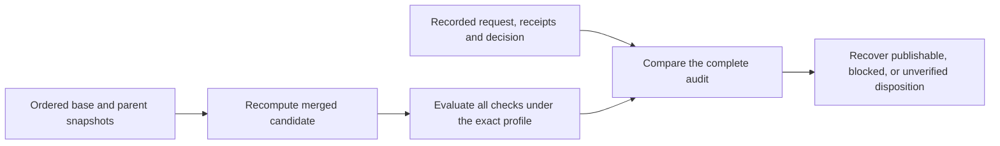

# RT-24 — Replay the merge validation decision

Is regenerating the same candidate sufficient to reproduce its validation decision? The [resolution replay experiment](RT-24-CONFLICT-RESOLUTION-REPLAY-2026-11-24.md) changes the context of a recorded conflict resolution. This fixture fixes a candidate obtained from two disjoint semantic edits and varies the evidence for the final validation outcome. The baseline on `research/all` is `8b8fe54ae4b8f185ab4b160a85f845d56aa9c1db`.

One parent increases a provider's capacity and cost. The other increases consumer demand. The candidate is a closed graph with enough capacity. The baseline validation profile requires closure, capacity and budget checks. The exact validation request binds the ordered base and parents, candidate and profile by hash. Each required receipt records the rule, status, reason and request hash. Audit replay normalizes receipt arrival order and compares the complete results to a fresh evaluation.



| Controls | Equal candidate | Verified audit |
|---|---:|---:|
| Exact acceptance and permuted receipt arrival | 2 of 2 | 2 publishable |
| Exact rejection under the lower budget | 1 of 1 | 1 blocked |
| Profile revision with equal outcomes, lower budget, swapped parents | 3 of 3 | 0 |
| Omitted failure, duplicate row, changed reason, mixed revisions, contradicted decision | 5 of 5 | 0 |

The candidate costs 7. The original budget of 8 admits it and the lower budget of 6 blocks it. An exact audit of the latter reproduces the rejection. A result-only check admits all eleven receipts as candidates for replay, including the record that omits the budget failure. Changing the profile revision with equal outcomes still changes the exact audit request under this policy. Both semantic parent orders produce the same graph, while the audit retains their ordered identities. [Raw inputs and both ledgers for each case](MERGE-AUDIT-REPLAY-01/evidence.json)

The candidate audit model records failures and checks for one complete inventory of required results. It assumes a trusted local verifier and a declared profile. It exercises finite records with complete checks. Unknown check results, secure retention, Git commit identity, external evidence lifetime and authorization to publish remain open. [Semantic merge issue](https://github.com/aivibeflow/LLMLang/issues/321)

## Reproduction

CPython 3.12.14 produced identical receipts with hash seeds 1 and 2. The diagram was checked as Mermaid source.

```bash
fixture=research/toolchain-and-collaboration/RT-24/MERGE-AUDIT-REPLAY-01
LC_ALL=C PYTHONHASHSEED=1 python3 -B "$fixture/run.py" > /tmp/llmlang-rt24-merge-audit.json
cmp "$fixture/evidence.json" /tmp/llmlang-rt24-merge-audit.json
```
