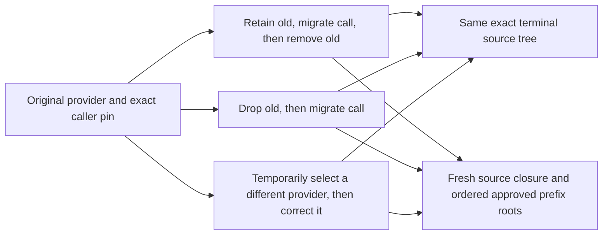

# RT-24 — Validate every retained semantic prefix after Git replay

- **Evidence** — Nine native Git replay paths over a closed, typed declaration inventory.
- **LLMLang baseline** — `8c672288cbb7c9f34b59f7a5d347625683e2e40e`.
- **Tracking** — [PLAN §4.5](../../../PLAN.md#45-end-to-end-semantic-merge-and-synchronized-commit-lifecycle) · [Proposed ADR-014](../../../draft/adr/014-git-semantic-merge.md).

## Question

Does a clean and approved final tree justify retaining every commit in a replayed series? The prior one-commit studies separated correct ancestry, source closure and the expected semantic patch. This experiment applies those distinctions to native multi-commit rebase, cherry-pick and an explicitly squashed net change. [Single-commit replay](RT-24-GIT-REPLAY-SOURCE-CLOSURE.md) · [Semantic patch correspondence](RT-24-SEMANTIC-PATCH-RECONCILIATION.md)

The closed project starts with a caller pinned to a provider version. The target changes only an ordinary file. The fixture specifies one approved three-step migration. First it retains the old provider while adding the desired new version. Next it migrates the exact call site. Finally it drops the old provider. A second topic drops the old provider before migrating the caller. A third topic keeps every commit closed but briefly selects a different provider that the approved sequence does not contain. All three topics have the same terminal declared source.



Each replay runs in a temporary Git repository. The harness captures the exact original source parent, source commits and destination. It checks the ordered parent chain and reads each new commit's tracked blobs into a fresh store. Comparison against the approved ordered roots uses the authored three-step control. The next check verifies the exact terminal call target and the preserved ordinary destination file.

## Results

All nine replay commands finish cleanly and produce one identical terminal Git tree and semantic root. Rebase and cherry-pick retain the ordinary destination file in each candidate. The ancestor checks distinguish the histories that terminal checking equates.

| Original history | Native rebase and cherry-pick, in both cases | Explicit squash |
| --- | --- | --- |
| Retain, migrate, remove | All three retained commits close and match the approved ordered roots. | The one new commit closes and matches the approved net change. |
| Drop, then migrate | First retained commit cannot resolve the still-pinned old provider. Second commit closes. | The one new commit closes and matches the approved net change. |
| Different closed prefix | All three retained commits close. The first root differs from the approved root. | The one new commit closes and matches the approved net change. |

A final-only policy accepts all nine paths. Checking fresh closure rejects the two retained broken histories. Comparing the complete ordered semantic prefixes distinguishes the two retained chains with the different provider and accepts the two retained chains matching the approved sequence. A warmer store with the base provider already present passes the internal graph audit on the broken prefix even though the exact provider is absent from its source inventory. Reproducibility from the Git tree therefore needs a fresh closed import or equivalent source-completeness evidence. [Exact trees, commits, roots and call-site evidence](MULTI-COMMIT-REPLAY-01/evidence.json)

Squashing replaces the sequence of new ancestors with one new commit. It can support an explicitly reviewed net-change policy for this fixture. Evidence for a retained history must cover each retained commit. An approved final snapshot alone leaves that claim unresolved.

## Implementation consequence

Git provides the physical history and candidate trees. The semantic admission step separately checks whether each required tree reconstructs and whether its exact changes correspond to the reviewed sequence. The caller migration decision belongs to the call site and can require temporarily retaining a provider. If a project allows squash, record authorization for the net change independently of approval for a retained chain. [RT-15 whole-graph merge](../RT-15/GIT-REPRESENTATION-AND-SEMANTIC-MERGE.md#54-whole-program-graph-merge) · [RT-20 call-site decisions](../RT-20/RT-20-LLM-PATCH-PLANNING-AND-HASH-PROPAGATION.md#42-caller-migration-decisions) · [RT-22 candidate boundary](../RT-22/RT-22-LLMLANG-GIT-REPOSITORY-AND-WORKTREE-MCP.md#8-semanticgit-consistency-boundary) · [RT-23 synchronization](../RT-23/RT-23-SINGLE-INSTANCE-TOOLCHAIN-AND-INCREMENTAL-MULTI-WORKTREE.md#92-commit-preparation-and-synchronization-protocol) · [RT-19 Change Sets](../RT-19/RT-19-TOOLCHAIN-SERVER-AND-SEMANTIC-DEVELOPMENT-API.md#42-change-set)

This fixture checks linear source history, structural inventory closure, and exact call bindings. It leaves textual conflicts, merge commits, arbitrary semantic equivalence, approval trust, full CIP coverage, crash recovery, and concurrent ref publication open.

## Reproduction

Run with Git 2.52.0 and CPython 3.12.14. The fixture fixes commit metadata and uses ordinary Git commands. The evidence retains both semantic roots and physical Git identities. [Replay](MULTI-COMMIT-REPLAY-01/run.py)

```sh
study=research/toolchain-and-collaboration/RT-24/MULTI-COMMIT-REPLAY-01
python3 -B "$study/run.py" --output /tmp/llmlang-replay-prefixes.json
cmp "$study/evidence.json" /tmp/llmlang-replay-prefixes.json
(cd research/PROTOTYPES/DEPENDENCY-GRAPH-01 && python3 -B -m unittest \
  tests.test_rt24_git_replay tests.test_rt24_merge_tree_gate \
  tests.test_rt24_replay_patch_correspondence tests.test_rt24_semantic_merge_core)
```
