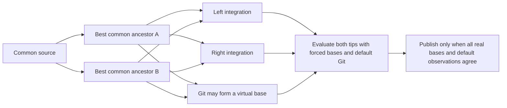

# RT-24 — Compare real and virtual Git merge bases before publication

Git produces a clean tree in six checks where the two real merge bases do not yield an agreed semantic result. In two of those checks, forcing either real base reports a conflict. The candidate gate allows four convergent results and preserves the publication ref in every other case.

## Question and scope

A three-way semantic merge needs a baseline against which changes are interpreted. A criss-cross history can have more than one best common ancestor. Git may combine those ancestors into a virtual base to perform its default merge. The same tips can then produce different outcomes under a forced real base and a virtual base. This experiment compares explicit real-base choices and a conservative rule requiring all real bases to agree on the result and ordered effects. [Git merge-base documentation](https://git-scm.com/docs/git-merge-base) · [Git merge strategy documentation](https://git-scm.com/docs/merge-strategies)

Each source tree separates a nonnegative return value and exactly two ordered effect events into distinct files. A note changes along one ancestor and is fixed on both tips. Two independently resolved merge commits have the same two ancestors in opposite parent order. Neither merge is an ancestor of the other. Git returns both incomparable commits under `merge-base --all` for every fixture.



## Method

The runner creates temporary bare Git repositories with files and reftable ref storage, pinned authorship and exact object identities. For each history and tip order, it runs native `merge-tree` with each forced ancestor and with the default merge-base policy. An independent semantic oracle performs three-way equality separately for the returned value and the ordered effect array. It checks each forced-base outcome against the decoded native tree. When independently merging the two ancestors is clean, explicitly using that resulting tree as a base exactly reproduces the default Git tree in the tested history.

The candidate publication rule requires a clean decoded result from every real base, equality across those observations and agreement with the default Git tree. It uses an expected-old-value ref update to publish the exact tree and parents in the disposable test. Failures preserve the old ref. The comparison tests one rule for unresolved ancestry and leaves room for explicit reviewed resolutions.

## Results

| Scenario | Forced A | Forced B | Default Git | All-base gate publishes |
| --- | --- | --- | --- | --- |
| convergent | clean | clean | clean | yes |
| convergent_effects | clean | clean | clean | yes |
| ancestral_result_disagreement | clean | clean | conflict | no |
| ancestral_trace_disagreement | clean | clean | conflict | no |
| synthetic_selects_new_result | clean | conflict | clean | no |
| synthetic_selects_new_trace | clean | conflict | clean | no |
| synthetic_with_two_refusals | conflict | conflict | clean | no |

Each scenario is exercised in both tip orders and both ref backends, for 28 repositories. The two backends have identical exact results. Per backend, 10 of 14 default Git merges are clean. Six of those 10 have incompatible or missing real-base observations. The gate publishes four. In the ancestral disagreement cases, both forced-base runs are individually clean. They select different values or different event order, respectively. Checking only the scalar would miss the second difference.

The strongest virtual-base case combines two changes that look conflicting from both real ancestors. Its default tree returns 3 and emits `d,a`. From A, there is a conflict over the effect sequence. From B, there is a conflict over the returned value. Merging the real bases first supplies a different baseline and makes both sides' later changes disjoint.

## Implications and limits

Git's default clean status gives an exact candidate tree but provides no evidence that every real merge base classifies the change the same way. A semantic protocol can require agreement across real bases, accept a bound synthesis rule for the virtual base, or require a resolution that records which ancestral interpretations are authoritative. The conservative gate can defer a valid merge that a stronger reviewed policy would admit.

The fixture covers two incomparable bases, two independently resolved tips and a closed two-observation source shape. It leaves more complex ancestor graphs, rename and deletion behavior, authenticated merge decisions, replay semantics, production Git hooks, and independent review open. It does not select a normative merge-base policy or assert that a virtual base is generally equivalent to pairwise ancestor merging.

## Reproduce

Use Git 2.52.0 and CPython 3.12.14. The ledger records all ancestor and tip IDs, candidate trees, observations and publication commits. The runner deletes only its temporary fixtures.

```sh
fixture=research/toolchain-and-collaboration/RT-24/MULTIPLE-MERGE-BASES-01
output=$(mktemp)
python3 -B "$fixture/run.py" --git "$(command -v git)" > "$output"
cmp "$fixture/evidence.json" "$output"
python3 "$fixture/chart.py"
```

[Native replay and semantic oracle](MULTIPLE-MERGE-BASES-01/run.py) · [Evidence ledger](MULTIPLE-MERGE-BASES-01/evidence.json)
