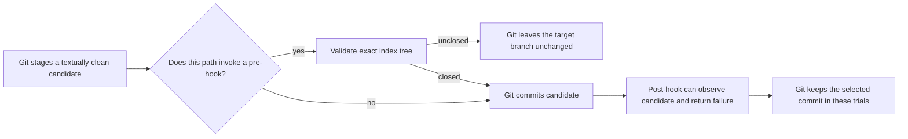

# RT-24 — Native Git hooks and the semantic publication boundary

Five native Git workflows let a pre-operation hook reject an unclosed semantic tree. Three workflows installed the unclosed tree even though a post-operation hook detected it and returned failure. The difference depends on the Git command and rebase backend. A checkout that requires an exact graph gate needs a publication boundary with coverage independent of those local hooks.

## Method

Git 2.52.0 ran eight commands against the existing RT-24 fixture. For each command, one incoming branch adds an independent definition and another pins a caller to an old callee. The receiving branch versions that callee. The edits occur in disjoint files and native textual application succeeds for both variants. Each input branch imports independently. The existing pure merge core predicts an unclosed candidate only for the incoming pinned caller.

The runner installs explicit hooks using a disposable repository's `core.hooksPath`. Each hook imports the exact staged tree and records its observation. It returns one if the graph is unclosed, even when invoked after Git has created a commit. The runner checks both the final branch commit and the actual HEAD. It exercises direct commit, automatic merge, automatic merge with `--no-verify`, manual merge followed by commit, cherry-pick, each rebase backend and `git am`.



## Results

| Operation | Hooks observing an unclosed tree | Git exit | Unclosed tree committed to target branch |
| --- | --- | ---: | --- |
| `commit` | `pre-commit` | 1 | no |
| `merge` | `pre-merge-commit` | 1 | no |
| `merge-no-verify` | `post-merge` | 0 | yes |
| `manual-merge` | `pre-commit` | 1 | no |
| `cherry-pick` | `post-commit` | 0 | yes |
| `rebase-merge` | `post-commit`, `post-rewrite` | 0 | yes |
| `rebase-apply` | `pre-applypatch` | 1 | no |
| `am` | `pre-applypatch` | 1 | no |

All eight closed controls reached the intended branch and matched the tree observed by the hooks. The eight rejected or installed unclosed candidates had no textual conflict stages. In the rejected `rebase --apply` case the target branch keeps its original exact tip, while HEAD stays detached at the onto commit and the unclosed candidate remains staged. Recovery therefore needs both the branch ref and the actual checkout state.

The automatic merge calls `pre-merge-commit`. Finishing a stopped `merge --no-commit` with an explicit commit calls `pre-commit`. The apply rebase and `git am` invoke `pre-applypatch`. The tested cherry-pick and merge-backend rebase invoke only the measured post-hooks, which observe the new commit. The explicit merge override suppresses `pre-merge-commit`. The ledger records exact hook order, observed HEAD and staged tree, command status and final branch commit.

## Implementation boundary

Local hooks can give earlier feedback and stop supported operations when installed and enabled. A Toolchain-controlled coordinator can validate the exact candidate before updating its authoritative ref and separately reconcile sanctioned Git workflows. The experiment measures hook ordering and the side effects of rejecting a pinned graph. It leaves interactive conflict continuation, multiple-commit partial progress, remote enforcement, differing Git releases and platforms, and synchronized concurrent publication open.

## Reproduce

Use Git 2.52.0 and CPython 3.12.14 in a POSIX shell. The runner installs hooks solely in temporary repositories and uses fixed Git identity and timestamps.

```sh
fixture=research/toolchain-and-collaboration/RT-24/NATIVE-GIT-HOOKS-01
output=$(mktemp)
python3 "$fixture/run.py" --output "$output"
cmp "$fixture/evidence.json" "$output"
python3 "$fixture/chart.py"
```

[Runner](NATIVE-GIT-HOOKS-01/run.py) · [Hook](NATIVE-GIT-HOOKS-01/hook.py) · [Evidence ledger](NATIVE-GIT-HOOKS-01/evidence.json) · [Native merge driver](RT-24-NATIVE-GIT-MERGE-DRIVER-2026-11-24.md) · [Git hook documentation](https://git-scm.com/docs/githooks)
