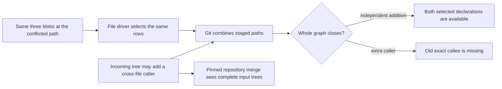

# RT-24 — Native Git merge-driver inputs and repository context

In Git 2.52.0, a custom driver saw the same file blobs and the same observed repository state in two cases where one result formed a closed semantic graph and the other lost an exact callee. The pair reproduced in merge, cherry-pick and rebase. A repository-level merge with explicit input revisions identified all three broken graphs.

## Experiment

The fixture configures a driver through `.gitattributes` for a single textual source path. Git supplies the base, current and incoming blobs through `%O`, `%A` and `%B`, along with the marker size and path through `%L` and `%P`. The driver hashes the three supplied files, reads the current HEAD and the caller blob in the current index, and checks for the three operation-head files and the two rebase state directories. The local-slot policy then runs the existing RT-24 conflict rules over exact declaration rows from that file and writes its candidate to `%A`.

The base sets a declaration to one version. The current branch changes that declaration and the incoming branch adds an independent declaration in the same file. In the second context, the incoming branch also adds a caller in a different file that uses the old declaration version. Both branch snapshots close independently, and the extra caller leaves every measured driver input unchanged. The experiment separately gives the complete pinned snapshots to the existing semantic merge core and imports the actual candidate Git tree if Git reports success.



## Native results

| Git operation | Policy | Context | Exit | Unmerged paths | Graph from Git index |
| --- | --- | --- | ---: | ---: | --- |
| merge | local-slots | independent | 0 | 0 | closed |
| merge | local-slots | external-caller | 0 | 0 | unclosed |
| cherry-pick | local-slots | independent | 0 | 0 | closed |
| cherry-pick | local-slots | external-caller | 0 | 0 | unclosed |
| rebase | local-slots | independent | 0 | 0 | closed |
| rebase | local-slots | external-caller | 0 | 0 | unclosed |
| merge | local-slots | same-slot | 1 | 1 | pending |
| merge | unconfigured | independent | 1 | 1 | pending |
| merge | missing | independent | 1 | 1 | pending |
| merge | require-context | independent | 1 | 1 | pending |
| cherry-pick | require-context | independent | 1 | 1 | pending |
| rebase | require-context | independent | 1 | 1 | pending |

Across all six local-slot compatibility cases Git returned zero. The complete-tree gate distinguished three closed candidates from three broken exact call graphs. The same-slot control returned nonzero and Git preserved the three unmerged stages. A driver configured to require explicit repository context also preserved the stages for each of the three operations. Git used built-in text conflict markers when the attributes named a driver with no local configuration. When a configured executable was missing, Git reported the invocation failure and kept the conflict pending.

The driver ran before Git exposed either branch-merge or cherry-pick metadata in the paths it checked. `rebase-merge` was visible during rebase, and the checked operation-head files were absent. In each pair the inspected index was still the current branch's view. The ledger records these observations and the exact detached or branch HEAD, input commits and resulting candidate trees. The probe covers those paths and arguments in this version of Git. Other operation modes and sources of context require separate validation.

## Implementation boundary

A file driver can suggest a deterministic candidate when a supported path conflicts. Returning zero allows native cherry-pick or rebase to create commits before any later whole-graph check. A repository coordinator can instead pin the operation inputs, examine all paths and revalidate the exact candidate before synchronized publication. Requiring explicit context at the adapter leaves a conflict pending where the coordinator is unavailable. Ordinary Git remains a textual fallback. Its success status cannot establish conditions on LLMLang graphs.

This is an isolated driver prototype for the existing acyclic JSON source fixture. Multi-base and multi-parent merges, driver setup across platforms, sender and repository trust, caller impact validation, and exact synchronized commit remain outside the experiment. The tool installation path and scopes are illustrative. The runner records exact patch roles without discovering them from driver internals.

## Reproduce

Use Git 2.52.0 and CPython 3.12.14 in a POSIX shell. The runner initializes disposable repositories and supplies the driver configuration locally with `git config merge.rt24.driver`. It exercises unconfigured fallback and a configured missing executable in separate repositories.

```sh
fixture=research/toolchain-and-collaboration/RT-24/NATIVE-MERGE-DRIVER-01
output=$(mktemp)
python3 "$fixture/run.py" --output "$output"
cmp "$fixture/evidence.json" "$output"
python3 "$fixture/chart.py"
```

[Runner](NATIVE-MERGE-DRIVER-01/run.py) · [Driver](NATIVE-MERGE-DRIVER-01/driver.py) · [Evidence ledger](NATIVE-MERGE-DRIVER-01/evidence.json) · [Git integration design](../RT-15/GIT-REPRESENTATION-AND-SEMANTIC-MERGE.md)
