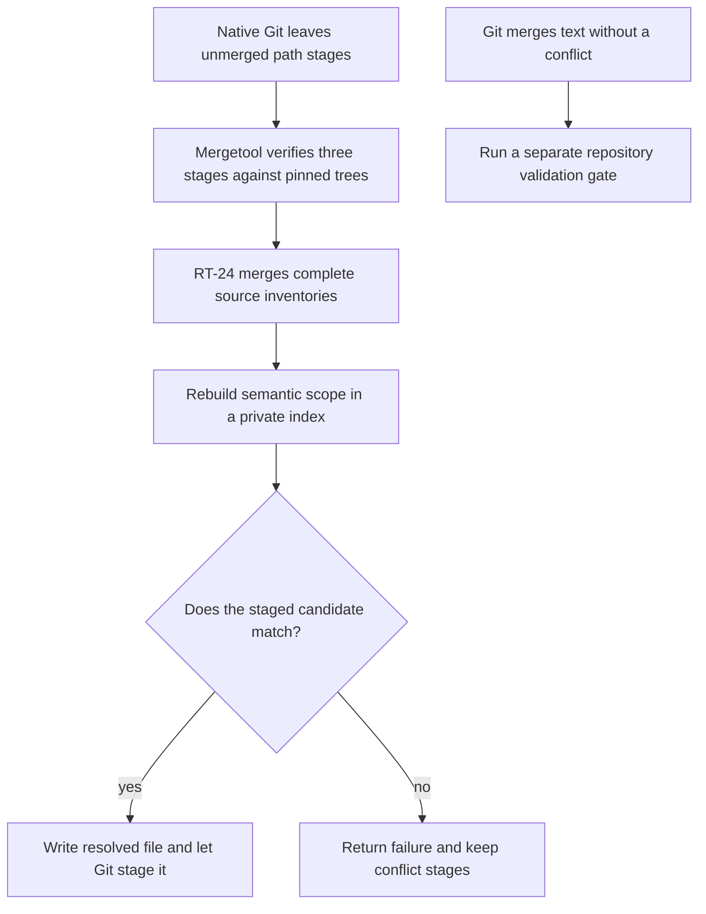

# RT-24 — Native Git mergetool and repository-wide validation

In twelve temporary repositories, Git 2.52.0 staged the file produced by a custom mergetool when the command returned success. The coordinator used complete pinned source inventories to resolve independent changes in one conflicting file and to preserve a separate ordinary-file conflict. A status-only control staged a valid but incomplete result that lost an independently added declaration. A different case produced a clean textual merge with a broken cross-file call and never entered the mergetool. The two controls distinguish preserving reviewed semantic changes from maintaining graph closure.

## Adapter and experiment

The prototype runs through Git's custom mergetool interface with `trustExitCode = true`. For the supported fixture it reads one `MERGE_HEAD`, finds a unique merge base and verifies that the three Git index stages, the pinned commit blobs and the three files delivered by Git have identical blob hashes. An index stage identifies a base, current-side or incoming-side blob for an unresolved path. The existing RT-24 slot merge imports each pinned tree independently and rebuilds the combined graph. The adapter writes the single resolved path only after a private index, populated from the actual staged state, imports to exactly the same semantic selections. It removes ordinary unmerged paths only from this private validation index. Git stages the resolved path in the real index and leaves ordinary conflicts pending.



## Native results

| Case | Tool | Unmerged paths before | Unmerged paths after |
| --- | --- | ---: | ---: |
| composable | coordinator | 1 | 0 |
| ordinary-conflict | coordinator | 2 | 1 |
| same-slot | coordinator | 1 | 1 |
| cross-file-conflict | coordinator | 1 | 1 |
| clean-text-invalid-graph | native Git | 0 | 0 |
| cherry-pick | coordinator | 1 | 1 |
| rebase | coordinator | 1 | 1 |
| composable | wrong-base | 1 | 1 |
| composable | coordinator | 1 | 1 |
| composable | status-only | 1 | 0 |
| composable | missing | 1 | 1 |
| ordinary-fallback | native Git | 1 | 1 |

The second composable coordinator case stages an unexpected valid declaration in a different file before invoking the tool. The private-index comparison detects the deviation. The wrong-base control substitutes the current-side temporary file for the base. Git's complete stage listings and the conflict bytes are identical before and after every failed mergetool attempt. The result ledger records distinct rejection reasons, exact branch commits and any tree that Git can write after the attempt.

A same-slot conflict returns its typed kind and slot pending an explicit resolution. The cross-file conflict has an exact call to a callee removed on the other branch. When the native tool executable is absent, Git reports failure and preserves the stages. A checkout without the custom config can use normal Git textual conflict handling. In that mode the conflict remains visible, and semantic validation is still required before treating the result as eligible for LLMLang publication.

## Implementation boundary

A local mergetool invocation is a useful path-level adapter over a repository coordinator. Git accepts a successful exit code as the resolution signal, so a separate exact-tree validation step must also cover merges where Git invokes no mergetool. The test compares an exit-status-only adapter, the coordinator and ordinary Git fallback. Importing a well-formed graph alone can still miss an intended independent change.

The prototype supports a single conflicted non-manifest source path in a regular two-parent merge with one base. It exercised refusal on real rebase and cherry-pick conflicts. Explicit operation context for those modes, interactive authorization for competing choices, multi-file resolution, merge-driver installation, platform coverage, and RT-20 caller and RT-23 publication checks remain open. The private index isolates semantic validation in this fixture. Git stages the tool output after the child exits, so an external writer can still change the real index or worktree across that boundary. Final approval needs fresh exact-tree validation in the synchronized commit protocol.

## Reproduce

Use Git 2.52.0 and CPython 3.12.14 in a POSIX shell. The runner configures only disposable local repositories. It disables user and system Git configuration and pins fixture commit timestamps.

```sh
fixture=research/toolchain-and-collaboration/RT-24/NATIVE-MERGETOOL-01
output=$(mktemp)
python3 "$fixture/run.py" --output "$output"
cmp "$fixture/evidence.json" "$output"
python3 "$fixture/chart.py"
```

[Runner](NATIVE-MERGETOOL-01/run.py) · [Adapter](NATIVE-MERGETOOL-01/mergetool.py) · [Evidence ledger](NATIVE-MERGETOOL-01/evidence.json) · [Closed three-way merge](RT-24-CLOSED-THREE-WAY-MERGE.md) · [Git integration design](../RT-15/GIT-REPRESENTATION-AND-SEMANTIC-MERGE.md)
