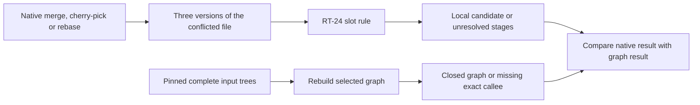

# RT-24 Replay of the native semantic merge driver

**Issue** [#322](https://github.com/aivibeflow/LLMLang/issues/322)

This replay checks that the existing Git driver calls the RT-24 selection rule for a conflicted path and identifies the limits of that adapter. The prototype question in §4.4 is whether Git can invoke the semantic merge logic under its normal entry points. The distinct workflow question is whether that invocation establishes a valid system-wide candidate. [Original driver experiment](RT-24-NATIVE-GIT-MERGE-DRIVER-2026-11-24.md)

## How the prototype works

Git passes three versions of one conflicted file to the driver. The configured driver imports the existing `resolve_slot` function from the semantic merge core fixture. It compares rows by selection slot, gives Git canonical candidate bytes on a local success, and exits nonzero for unresolved slots. The separate coordinator exercises the same selection rules with complete pinned inputs. It attempts a fresh graph rebuild that can detect a caller outside the conflicted file whose exact target is unavailable. A second driver mode refuses file-only context and preserves the conflict stages for a repository-aware workflow. [Driver source](NATIVE-MERGE-DRIVER-01/driver.py) · [Semantic merge core fixture](../../PROTOTYPES/DEPENDENCY-GRAPH-01/tests/test_rt24_semantic_merge_core.py)



The diagram shows the comparison that matters for integration. The file adapter sees blob inputs at one path. A repository-level gate can verify whether the combined caller and callee selections form a closed graph. Using native text resolution as the sole criterion also leaves cross-file graph closure unchecked. Refusing without explicit context preserves conflict stages and may require manual input for cases that could later be resolved using the complete trees.

## Verification outcome

Two fresh executions from the archive at `09bb147f0d8cfd054956dd385889e7853e2011c0` reproduced the original twelve-case ledger byte for byte. Git 2.52.0 and CPython 3.12.14 match the recorded tools. The regenerated categorical table matched the published table row for row. All thirteen tests in the independent core and graph rebuild suites passed.

| Native ledger classification | Cases |
| --- | ---: |
| Git succeeds and the staged graph closes | 3 |
| Git succeeds and the staged graph loses an exact callee | 3 |
| Git keeps stages 1, 2 and 3 unresolved | 6 |

In all three paired native operations, the two cases disagree on graph closure while the observed driver arguments and probed repository state agree. Four successful cherry-pick or rebase cases advance the Git commit before the fixture's graph gate, two with missing exact callees. This establishes the native prototype invocation and replay for this fixture. It keeps broader coordinator and pre-publication validation work open. The [replay receipt](NATIVE-MERGE-DRIVER-REPLAY-01/evidence.json) carries source and output hashes and counts. The retained original ledger and table generator preserve the underlying per-case data. No elapsed-time or resource measurements were taken.

## Reproduce

Run from repository root. The selected archive excludes current working files from the experiment. Mermaid source syntax and relative links were checked locally. GitHub visual rendering was not manually verified.

```sh
set -eu
rev=09bb147f0d8cfd054956dd385889e7853e2011c0
driver=research/toolchain-and-collaboration/RT-24/NATIVE-MERGE-DRIVER-01
prototype=research/PROTOTYPES/DEPENDENCY-GRAPH-01
stage=$(mktemp -d)
git archive "$rev" "$driver" "$prototype" | tar -x -C "$stage"
for seed in 1 2; do
    LC_ALL=C PYTHONHASHSEED="$seed" PYTHONDONTWRITEBYTECODE=1 python -B \
        "$stage/$driver/run.py" --output "$stage/seed$seed.json"
    cmp "$stage/$driver/evidence.json" "$stage/seed$seed.json"
done
python -B "$stage/$driver/chart.py" > "$stage/table.md"
(cd "$stage/$prototype" && python -B -m unittest -q \
    tests.test_rt24_semantic_merge_core tests.test_rt24_merge_tree_gate)
sha256sum "$stage/seed1.json" "$stage/seed2.json" "$stage/table.md"
```

The replay covers a single-path driver and the archived closed JSON profile. Multi-base conflicts, additional repository context sources, target-specific setup, semantic contract validation and a transactional deployment remain outside its scope.
