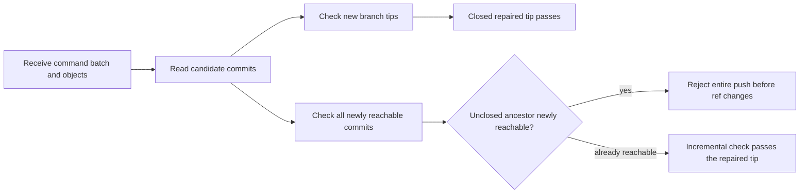

# RT-24 — Exact semantic validation at Git receive

A Git receiver that checks only new branch tips accepted a closed tip with an unclosed ancestor. A gate that checked every newly reachable commit rejected that same push. A separate per-ref check let the good branch of a non-atomic mixed push move even though Git reported failure. An atomic push preserved both original refs.

## Experiment

The runner sends Git 2.52.0 pushes to local bare repositories. The source fixture contains a closed base, an independent ordinary edit, an unclosed commit with an obsolete exact callee pin and a repaired tip whose first parent is the unclosed commit. The receiver starts with the checked base at two branch refs unless the trial explicitly seeds the unclosed commit under a third ref.

| Candidate gate | Exact checks |
| --- | --- |
| None | Git applies its ordinary ref-update rules. |
| Per-ref `update` | Each proposed branch tip is checked separately. Git enforces its own transaction behavior. |
| Transaction `pre-receive`, tips | The hook checks the distinct new branch tips from the complete received command batch. |
| Transaction `pre-receive`, history | The hook runs `rev-list` from all received tips and excludes commits already reachable from existing receiver refs. It checks every distinct commit in that increment. |

Each check opens the exact commit's Git tree using the existing closed RT-24 importer. It verifies that source inventory and references reconstruct a closed semantic graph. The runner independently reads final refs, proves which received commits are reachable and probes whether the rejected commit object was retained by Git.



## Results

| Gate | Push | Atomic | Unclosed history already present | Exit | Unclosed commit reachable |
| --- | --- | --- | --- | ---: | --- |
| none | mixed | no | no | 0 | yes |
| update | mixed | no | no | 1 | no |
| update | mixed | yes | no | 1 | no |
| tips | mixed | no | no | 1 | no |
| history | mixed | no | no | 1 | no |
| tips | repaired | no | no | 0 | yes |
| history | repaired | no | no | 1 | no |
| history | repaired | no | yes | 0 | yes |
| history | duplicate-tip | no | no | 0 | no |
| history | delete | no | no | 0 | no |

In the mixed push, the per-ref gate rejected the bad branch and moved the good branch when Git allowed a partial update. With `--atomic` it left both refs at the base. The transaction gates rejected both refs together with the ordinary non-atomic client request. Their rejected objects were visible in Git quarantine during the checks and disappeared afterward. Git retained the unclosed object after both per-ref rejections even though no accepted ref made it reachable. Ref state, object retention and command status therefore answer different questions.

On the repaired branch, the tip-only policy sees one closed commit. The history policy sees the repaired tip and its newly reachable unclosed ancestor. When an existing receiver ref already reaches that ancestor, the incremental gate sees only the repaired tip. A history-wide condition thus depends on a verified receiver baseline or a separate historical audit. The deletion-only control has no candidate commit and starts no quarantine. The two-ref same-tip control checks the common commit once.

## Implementation boundary

Choose the enforced condition explicitly. A branch-tip gate supports workflows that retain intermediate states in history. A closure condition for every newly reachable commit requires a transaction-wide history check and a baseline policy. Per-ref feedback can reduce the rejected scope. Transaction checks provide an all-or-none decision for the tested push batch. A hosted Git service may expose different enforcement surfaces. This fixture leaves hosted administration and bypass authority, concurrent pushes, signed approvals, mapping and proof receipts, and required RT-20/RT-23 integration open.

## Reproduce

Use Git 2.52.0 and CPython 3.12.14 in a POSIX shell. The runner pushes only to isolated local bare repositories and records exact requested commits, checked tree identities, quarantine observations and resulting branch refs.

```sh
fixture=research/toolchain-and-collaboration/RT-24/NATIVE-RECEIVE-GATE-01
output=$(mktemp)
python3 "$fixture/run.py" --output "$output"
cmp "$fixture/evidence.json" "$output"
python3 "$fixture/chart.py"
```

[Runner](NATIVE-RECEIVE-GATE-01/run.py) · [Receive checks](NATIVE-RECEIVE-GATE-01/receive.py) · [Evidence ledger](NATIVE-RECEIVE-GATE-01/evidence.json) · [Git receive documentation](https://git-scm.com/docs/git-receive-pack)
