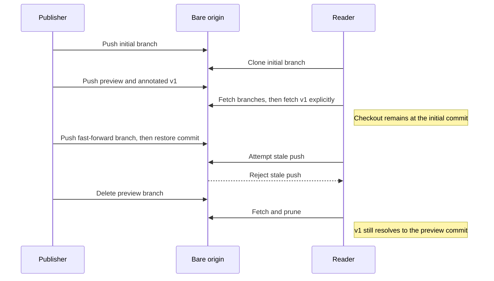

# RT-24 Native Git ref transport and typed snapshots

**Issue** [#320](https://github.com/aivibeflow/LLMLang/issues/320)
**Evidence** Bounded native Git integration experiment. The repository and semantic schemas are candidates.

The Git repository model must preserve how collaborators clone a repository, publish branches and tags, fetch without changing their checkout, and inspect retained history. LLMLang additionally needs to know which exact typed program each selected revision supplies. This study checks whether the closed-inventory fixture can reconstruct that program after ordinary ref transport, including after branch deletion and a later restore of the original program bytes.

## Mechanism and alternatives

A ref is a mutable name for a Git object. An annotated tag has its own object identifier and refers here to a commit. To reconstruct a selected program, resolve the ref to a commit, take that commit's tree, then admit the declared inventory from verified Git blobs and compute the typed semantic root. The semantic root identifies the admitted typed snapshot. The Git commit identifies revision history and participates in ordinary fast-forward policy. The prior [identity mapping study](RT-24-COMMIT-TREE-SEMANTIC-ROOT-MAPPING-2026-11-25.md) covers equal trees with distinct ancestry.

One could instead read the checked-out program whenever a remote-tracking ref is inspected. That saves a separate object lookup when the checkout happens to match, but a fetch alone changes only the remote-tracking ref in this schedule. One could also equate equal typed roots with equal Git revisions. This would collapse the restore and initial revisions, obscuring the intervening provider change and published release. A custom transport could carry a precomputed graph, at the cost of defining when that graph matches the selected commit. The experiment uses native transport and computes the snapshot from the received tree.



The illustrative sequence condenses the reader's two separate fast-forward operations. Snapshot reconstruction always starts from the selected Git ref and its commit tree. The tag remains resolvable after removal of the preview branch in this schedule.

## Method and results

The runner makes two isolated sets of bare origin, publisher and clean reader repositories. It uses a local `file://` remote with Git 2.52.0, SHA-1 and SHA-256 object formats, and Python 3.12.14. No LLMLang hook, database or custom protocol is needed by these fixtures. The snapshot importer uses the two-file closed profile from the prior study. The single entry calls the selected addition or subtraction provider at inputs −1, 0 and 1. The candidate reader explicitly validates the typed graph on each reconstruction.

| Native control | Checked outcome in both formats |
| --- | --- |
| Initial push and clone | Origin and clone resolve the same initial commit, tree, root and outputs `[0, 1, 2]`. |
| Preview push and branch-only fetch | The new remote-tracking ref resolves to the subtraction snapshot with outputs `[-2, -1, 0]`. Reader HEAD remains on addition. |
| Explicit fetch of annotated tag | The tag object differs from its target commit and peels to the exact preview revision. |
| Branch promotion | Publisher and reader independently fast-forward to the already observed preview commit. Fetch alone leaves reader HEAD at its old value. |
| Restore and attempted stale push | Git rejects the stale update. The reader later obtains the exact published restore commit, with the initial tree and semantic root and with preview as its parent. |
| Delete preview and fetch with prune | The preview remote-tracking branch disappears. The tag still reconstructs the preview snapshot. The entire three-commit branch history is present and passes `git fsck --full`. |

Across the two formats, the three checkpoints have different Git commit and tree identifiers and identical corresponding semantic roots and outputs. The [ledger](NATIVE-REF-TRANSPORT-01/evidence.json) records six checkpoint rows, eighteen interpreted output values and the exact three-commit histories. The table presents categorical assertions and exact values. There are no time or size measurements.

## Reproduction and limits

Run from repository root. The runner verifies its helper and semantic prototype modules against the archived bytes at `e1695217c29d59437e306748bc9faf2dfd7e4353`. Two runs with hash seeds 1 and 2 produced byte-identical ledgers. The runner and dependency hashes are in the ledger. Relative links and Mermaid block syntax were checked locally. GitHub visual rendering was not manually verified.

```sh
study=research/toolchain-and-collaboration/RT-24/NATIVE-REF-TRANSPORT-01
PYTHONHASHSEED=1 python -B "$study/run.py" > /tmp/llmlang-native-ref-evidence.json
cmp "$study/evidence.json" /tmp/llmlang-native-ref-evidence.json
```

This establishes compatibility with the named commands for one closed snapshot profile and two object formats. Paths chosen by the importer must still satisfy the selected schema. Hosted branch protections, authenticated transports, signed tags, concurrent publication, forced updates, partial clones and garbage collection of unreachable history are outside this experiment. Production review must decide which refs may publish evidence and how to transport required external dependencies. This study provides no decision about that authority or the final repository storage format.
