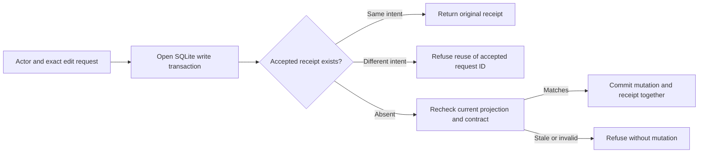

# RT-24 optimistic graph edits and durable retry receipts

An optimistic graph edit can atomically publish its mutation and a durable receipt. In 24 native SQLite schedules, process exit before commit leaves neither record. Exit after commit leaves both. A retry of the same accepted request retrieves the original result even after another edit changes the current graph.

## Candidate rule

The fixture uses enabled graph nodes with integer weights and a capacity contract. A proposal changes one node by a requested delta. Its read projection includes the old weight and exact contract. The normalized request binds the actor, request ID, target node and delta. An accepted request retains a receipt addressed by actor and request ID.



For an uncommitted stale request, a new attempt requires a fresh projection and contract check. A committed retry returns the earlier observation without reapplying the effect. An actor can use its own request ID namespace. The fixture assumes the actor field was authenticated before admission. [Optimistic graph predicates](RT-24-CONCURRENT-GRAPH-2026-11-25.md)

## Results

The replay crosses three publisher exit points, same or independent peer nodes, same or different peer actors, and equal or altered retry intent. The original writer runs in a separate process. A controlled `os._exit` interrupts it immediately before or after SQLite commit, with normal return as the third case.

| Retry against original projection | Cases | Result |
| --- | ---: | --- |
| Replay | 8 | Same intent returns the saved weight. |
| ID conflict | 8 | Different intent under an already committed key is refused. |
| Applied | 4 | No accepted receipt exists and the peer left the projection unchanged. |
| Stale | 4 | No receipt exists and the peer changed the same node. Two unchanged-intent cases then apply after refreshing the projection. |

A separate duplicate submission from two processes applies once and returns one replay with the same receipt. A second actor can use the same request-ID string for its own accepted edit. A contract-only update makes the prior projection stale, and refreshing still refuses the requested delta when the new bound disallows it. Every tested path checks durable graph weights and receipt counts.

The result covers a local SQLite transaction and process exit. Power loss, external side effects, distributed keys, receipt expiration, authenticated principal assignment and completeness of projections for general graph edits require separate evidence.

## Reproduce

Use CPython 3.12.14 and SQLite 3.53.1. Both Python hash seeds 37 and 71 produced evidence SHA-256 `9978c40b7fdc62cea12530a1723d9adc8be18788a7ef7bfc23b8f3fc72bc1a9e`. [Evidence ledger](OPTIMISTIC-RETRY-01/evidence.json)

```sh
LC_ALL=C PYTHONHASHSEED=37 PYTHONDONTWRITEBYTECODE=1 \
  python research/toolchain-and-collaboration/RT-24/OPTIMISTIC-RETRY-01/check.py > /tmp/rt24-retry.json
```
