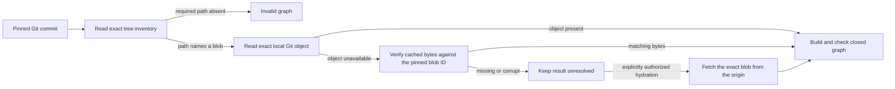

# Reconstruct a pinned graph in sparse and partial Git clones

LLMLang needs to distinguish source that is outside a local checkout, a promised blob unavailable to an importer, and a source dependency actually absent from the committed tree. This fixture exercises those states with native Git, then compares exact reconstruction through local Git objects, checked cache entries and ordinary working files. [Candidate repository contract](RT-24-CANONICAL-SEMANTIC-REPRESENTATION-DIFF-AND-MERGE.md) · [RT-23 File Views](../RT-23/RT-23-SINGLE-INSTANCE-TOOLCHAIN-AND-INCREMENTAL-MULTI-WORKTREE.md)

## Native fixtures and admission

A committed entry refers to one caller, and the caller refers to an integer provider kept in another directory. The old and current trees keep the exact same entry and caller blobs. They differ only in the provider value, which changes from 11 to 17. A third commit removes the required provider while retaining its caller. The independent reference reads the current expected value and evaluates four fixture inputs.

Eleven clone settings run under both Git SHA-1 and SHA-256 object formats. Git's local file transport produces real full, depth-one and blobless clones. Sparse clones check out only the entry directory with cone mode. The runner verifies Git's shallow and promisor settings and compares object availability without lazy fetching. The explicitly authorized hydration setting retrieves the two exact missing blob IDs from the named fixture origin without expanding the sparse checkout. No external network service is used.



The working-file policy reads the visible paths. Its path-cache variant also accepts a fallback entry by filename. Both use the current filesystem namespace without pinning it to the commit. The pinned Git policy reads the immutable tree inventory and exact local blobs. The pinned cache variant accepts byte payloads only if the committed tree names the same Git blob ID and recomputing the blob ID from the payload agrees. This includes the Git blob framing, which depends on the declared object format. Import checks the closed typed references and computes a semantic root over the operation and provider value.

The older cache is populated from the exact old Git tree. The corrupt-cache control puts those old bytes under the identifier of the new blob. The missing-target control warms the path cache from the valid current commit, then imports the later broken commit. The dirty-overlay control changes the working copy without staging or changing the Git commit. These cases distinguish exact tree membership, local object availability, cache consistency and the working overlay.

## Results

| Reconstruction policy | Exact | Wrong acceptances | Available snapshots refused | Expected refusals |
|---|---:|---:|---:|---:|
| Visible working files | 4 | 2 | 6 | 10 |
| Working files with path cache | 6 | 8 | 4 | 4 |
| Pinned tree and local Git blobs | 10 | 0 | 2 | 10 |
| Pinned tree and verified blob cache | 12 | 0 | 0 | 10 |

The four policies each run over 22 cases. Working-file reconstruction accepts a dirty provider and returns the previous result. Path-cache use additionally accepts stale bytes, the deliberately mislabeled cache payload, and a deleted provider with a matching old path. The exact cache policy reconstructs every available snapshot and distinguishes six unavailable cases, two corrupt entries and two absent dependencies. It records which blobs came from each source. An offline verified hit supplies the exact result without changing Git object availability or materializing new working files.

A full-object sparse checkout and a shallow clone both have the bytes needed for the current graph. Depth-one history is sufficient only for this tip reconstruction. A blobless clone can enumerate a complete tree without holding its payload. Fetching exact promised blobs can make the graph available while the filesystem view remains sparse. A cache hit supplies a payload for a named object. It cannot add a dependency to the authoritative tree.

## Scope and reproducibility

The comparison supports storing exact tree membership separately from a checkout's visibility and the availability of immutable object bytes. It tests one closed acyclic graph with ordinary tracked files and a controlled local Git origin. General graph extraction, submodules, LFS, server outages, interrupted retrieval, long-lived retention and garbage collection, arbitrary cache governance and independent review remain open. Broader portability requires testing the selected Git transport, target and repository representation.

Use Git 2.52.0 and CPython 3.12.14. The initial LLMLang base is `b43f21ed3559685ae26ac5d44ad44fc1ca2b3c00`. The observation ledger preserves the exact commit and tree, path-to-blob inventory, working visibility, availability before and after explicit hydration, and each policy's reads and outcomes.

```bash
fixture=research/toolchain-and-collaboration/RT-24/PARTIAL-SPARSE-RECONSTRUCTION-01
PYTHONHASHSEED=1 python3 -B "$fixture/run.py" > /tmp/llmlang-partial-sparse.json
cmp "$fixture/evidence.json" /tmp/llmlang-partial-sparse.json
python3 "$fixture/chart.py"
```

[Native runner](PARTIAL-SPARSE-RECONSTRUCTION-01/run.py) · [Observation ledger](PARTIAL-SPARSE-RECONSTRUCTION-01/evidence.json) · [Table generator](PARTIAL-SPARSE-RECONSTRUCTION-01/chart.py)
