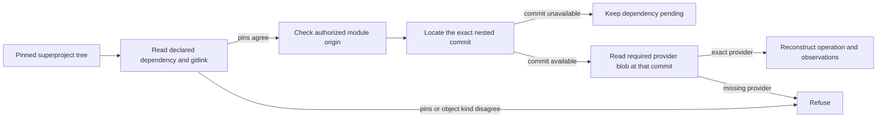

# Reconstruct an exact Git submodule dependency

A Git superproject can track a submodule commit in a gitlink while the nested working tree, nested HEAD and upstream branch tip all differ. LLMLang needs to reconstruct the dependency selected by the superproject and distinguish the policy governing its source. This study compares those read modes with a commit-bound importer. [Canonical repository contract](RT-24-CANONICAL-SEMANTIC-REPRESENTATION-DIFF-AND-MERGE.md) · [Sparse and partial clone boundary](RT-24-PARTIAL-SPARSE-RECONSTRUCTION-2026-11-25.md)

## Inputs and admission

The superproject tracks a dependency declaration and a `.gitmodules` entry. The declaration identifies an integer operation, the submodule path and the exact expected provider commit. An independent `git ls-tree` read pins the path's mode-160000 entry, called a gitlink. The external fixture repository holds provider versions returning a delta of 11 or 17. Another commit preserves the exact old provider blob and changes an ordinary note, and a fourth removes the provider blob. Both repositories use SHA-1 in this fixture.

The strict route compares the pinned gitlink with the declaration, verifies the recorded module path and the configured source against the fixture policy, and reads the required provider blob from exactly the selected external commit. The external Git objects may be present in a nested checkout or in a separate bare repository. Missing external access or an uninitialized dependency yields an unavailable result. A regular directory in place of a gitlink, a missing value within an available pinned commit, a disagreeing pin and an unapproved module origin fail at distinct gates. The origin check applies an explicit local policy, including when another origin has exactly the same Git objects.



The three controls read the working file by path, the nested HEAD, or the configured origin's live `main` tip. The runner uses native file transport, normal and recursive clone, explicit submodule update, `submodule update --remote`, direct Git object reads, and `git archive`. The exact comparisons require both the declared commit and the bounded operation result on four inputs. The links use temporary local fixture repositories.

## Results

Thirteen native settings include ordinary clone without access, recursive clone, explicit pinned checkout, a preloaded bare object store without checkout, remote update, dirty overlay, unavailable origin, and controls for dependency divergence and missing inputs. The available pinned cases can be reconstructed after checkout, from the nested object's correct historic commit, or from the separately loaded object store.

| Reconstruction policy | Exact | Wrong acceptances | Available dependencies refused | Expected refusals |
|---|---:|---:|---:|---:|
| Read the nested working file | 3 | 6 | 1 | 3 |
| Read the nested HEAD | 4 | 4 | 1 | 4 |
| Read the configured origin tip | 1 | 10 | 0 | 2 |
| Validate manifest, gitlink and exact origin | 7 | 0 | 0 | 6 |

Native `submodule update --remote` follows the source branch's newer commit and leaves the recorded gitlink unchanged. In the equal-payload case, the observed bytes agree but nested HEAD is a different commit, so the working-file and HEAD routes cannot establish the declared dependency. Dirty working bytes change only the first route. In the mirror case both native Git revisions and payload bytes agree, while the chosen origin disagrees with the fixture policy. The strict route refuses an unavailable origin and an available commit without the required object for different reasons.

None of the twelve superproject archives with gitlinks includes the nested provider. The regular-file control includes it and gives the working-file route enough bytes to accept a snapshot that violates its declared dependency boundary. The outer Git tree can prove which nested commit is required. Reconstruction needs the corresponding separately available objects.

## Scope and replay

This tests one ordinary submodule and one required value in each of thirteen temporary Git clone settings. It leaves production repository naming and origin governance, remote credentials, retained-object policy, network failures beyond temporary unavailability, recursive dependency cycles, multiple object formats and independent review open. Embedding provider bytes directly, or distributing them with a separately bound artifact, remains an alternative for a self-contained clone.

Use Git 2.52.0 and CPython 3.12.14 on Linux. The initial LLMLang baseline is `56e675ba1bde0e38c80f6025d423668277061267`. The ledger preserves superproject and provider commits, the manifest/gitlink relation, archive membership, actual nested and external refs, and the exact observations and classifications.

```bash
fixture=research/toolchain-and-collaboration/RT-24/GITLINK-RECONSTRUCTION-01
PYTHONHASHSEED=1 python3 -B "$fixture/run.py" > /tmp/llmlang-gitlink-reconstruction.json
cmp "$fixture/evidence.json" /tmp/llmlang-gitlink-reconstruction.json
python3 "$fixture/chart.py"
```

[Native fixture](GITLINK-RECONSTRUCTION-01/run.py) · [Observation ledger](GITLINK-RECONSTRUCTION-01/evidence.json) · [Table generator](GITLINK-RECONSTRUCTION-01/chart.py)
