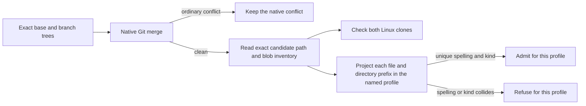

# Check Git path identity against a declared naming profile

RT-24 must reconstruct an exact program from a Git tree, and RT-23 identifies case-folding differences as a File View recovery case. A clean merge can preserve byte-distinct paths that a declared checkout profile identifies as one location. This study compares name checks after a native merge and confirms what Linux and Git actually materialize. [RT-24 candidate contract](RT-24-CANONICAL-SEMANTIC-REPRESENTATION-DIFF-AND-MERGE.md) · [RT-23 File View contract](../RT-23/RT-23-SINGLE-INSTANCE-TOOLCHAIN-AND-INCREMENTAL-MULTI-WORKTREE.md#11-failure-and-recovery)

## Scope and comparison

A fixture repository contains one fixed profile declaration and two branches that each add a file with distinct exact contents. Each branch is individually compatible with the declared naming profile. Native Git either merges them or exposes an unresolved ordinary conflict. The experiment imports actual NUL-delimited Git tree entries, checks their exact blob IDs and checks both files in two independent clean Linux clones of every clean result. One clone sets `core.ignorecase=false` and the other sets it to `true`. This changes a Git option while leaving the underlying Linux name resolution the same.

The candidate profile normalizes each UTF-8 component to Unicode NFC, applies default Unicode case folding, and normalizes to NFC again. File identity under that profile is the sequence of projected components. The complete-profile gate also requires each directory prefix to correspond to a single exact spelling and kind. For example, `Pkg/one.ll` and `pkg/two.ll` have distinct projected complete paths but a shared projected directory, which would change the recovered directory inventory. `Doc` and `doc/api.ll` require the same projected name to be both a file and a directory.



The byte-exact route validates the result on the current Linux file system. An ASCII-only check catches complete names that differ only by ASCII letter case. A Unicode complete-path check adds equivalences such as composed and decomposed accents or `Straße` and `STRASSE`. The prefix check additionally detects directory aliasing and file/directory conflicts. Requiring one exact spelling per projected prefix favors portable exact reconstruction and rejects otherwise composable edits to independently spelled directory paths. The profile preserves the distinction between dotted `İ` and unmarked `i`, full-width and ordinary Latin forms, and letters from different scripts in the tested controls.

## Measured results

Sixteen native histories produce fourteen clean two-parent merges and two ordinary conflicts. Both native conflicts retain the original branch tip and an unresolved index. All 28 clean clones restore the exact paths and blob contents and pass `git fsck`. One clone, containing `Pkg/Rate.ll` and `pkg/rate.ll` with `core.ignorecase=true`, subsequently exits `128` from `git add -A` with a file alias diagnostic. It leaves the index unchanged. The other 27 staging attempts exit successfully with unchanged indexes.

| Admission policy | Valid candidates admitted | Profile collisions missed | Profile collisions refused | Valid candidates refused |
|---|---:|---:|---:|---:|
| Exact Git paths and Linux checkout | 6 | 8 | 0 | 0 |
| ASCII case-insensitive complete paths | 6 | 6 | 2 | 0 |
| Unicode profile on complete paths | 6 | 4 | 4 | 0 |
| Unicode profile on files and directory prefixes | 6 | 0 | 8 | 0 |

The table covers the fourteen native clean candidates and evaluates admission to the declared profile. The Unicode complete-path gate misses two directory spelling conflicts with disjoint descendants and two projected file/directory collisions. Each of the eight profile collisions is live in a tree that a case-sensitive Linux clone can reconstruct. Clone success and the behavior of one Git flag therefore provide distinct evidence from a declared checkout contract.

## Limits and replay

The result supports tying path admission to the exact merged tree and an explicit name-profile version. The measured Linux OverlayFS distinguishes names for every clean fixture. Unicode 15.0.0 NFC and default case folding define the candidate profile for these comparisons. Real macOS, Windows and case-folded Linux filesystem behavior, reserved names, symlinks, permission rules, broader semantic graph closure and concurrent worktree updates remain open. The experiment establishes no accepted platform profile or repository design decision.

Run with CPython 3.12.14, Unicode data 15.0.0 and Git 2.52.0. The initial LLMLang base is `2e0a786c6298bc7856195f95c49796beae07a35e`. The ledger records the precise parent and candidate identities, path-to-blob mappings, native clone digests, staging diagnostics and each profile decision.

```bash
fixture=research/toolchain-and-collaboration/RT-24/PROFILE-BOUND-PATHS-01
PYTHONHASHSEED=1 python3 -B "$fixture/run.py" > /tmp/llmlang-git-path-profile.json
cmp "$fixture/evidence.json" /tmp/llmlang-git-path-profile.json
python3 "$fixture/chart.py"
```

[Native histories and profile gates](PROFILE-BOUND-PATHS-01/run.py) · [Observation ledger](PROFILE-BOUND-PATHS-01/evidence.json) · [Table generator](PROFILE-BOUND-PATHS-01/chart.py)
