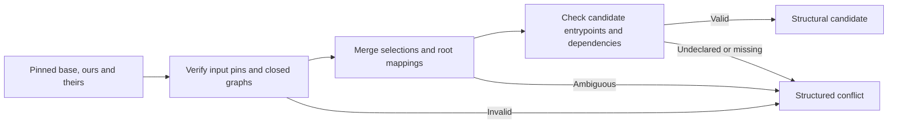

# RT-24. Pure three-way merge for a closed declaration inventory

The prototype composes three pinned semantic snapshots under one explicit closed-inventory policy. It reuses the existing selection merge and exact graph audit. Each input pin also identifies its entrypoint mapping and closed-context profile. The core reads an immutable content view and can return a structural candidate or typed conflicts. Git operations and publication are outside this module. [Issue #321](https://github.com/aivibeflow/LLMLang/issues/321) · [Earlier closed-inventory experiment](RT-24-CLOSED-THREE-WAY-MERGE.md)

For a known selection, one changed side wins and two identical replacements converge. Independently introduced selections at the same key require occurrence or lineage evidence, even if their value hashes are equal. A divergent edit to an existing typed call target is classified as a retarget conflict. The core also checks both input and candidate entrypoints and requires every reachable declaration to be selected by the corresponding inventory.



## Results

The independent oracle compares 4,096 two-slot cases and replays each with ours and theirs exchanged. It expects 1,369 resolved candidates and 2,727 conflicts. All predictions agree. Side reversal preserves each candidate and exchanges the conflict versions while retaining the subject and conflict kind. The content store is unchanged. The 31 existing graph-audit and merge tests also pass. [Finite ledger and conflict payloads](PURE-MERGE-CORE-01/evidence.json)

| Structural control | Result |
| --- | --- |
| Two divergent retargets of an existing call | Exact `dispatch/direct` retarget conflict |
| Replace a callee on one side, add a caller of the old callee on the other | Dependency conflict even when the old object is available from the store |
| Retain the old callee under an explicit alias | A closed structural candidate |
| Conflicting entrypoint changes or a retarget to a deleted selection | Root conflict |
| Invalid exact input pin or semantic root | Root conflict with the affected input role |
| Open-world graph context | Unsupported-context conflict |

The core assumes the supplied base is the intended common ancestor and that the explicit inventory is complete for its declared context. Full lineage interpretation, ancestry discovery, dynamic dependencies, behavioral equivalence, CIP approval and coordinated Git publication remain open. The prototype's entrypoint binding and equality rules are fixture policy.

## Replay

Source baseline `0e0e61e` on `research/all`. Replay used CPython 3.12.14 and Git 2.56.1 on Linux. Run from the repository root.

```sh
data=research/toolchain-and-collaboration/RT-24/PURE-MERGE-CORE-01
receipt=$(mktemp)
python -B "$data/run.py" "$receipt"
cmp "$data/evidence.json" "$receipt"
rm "$receipt"
```
