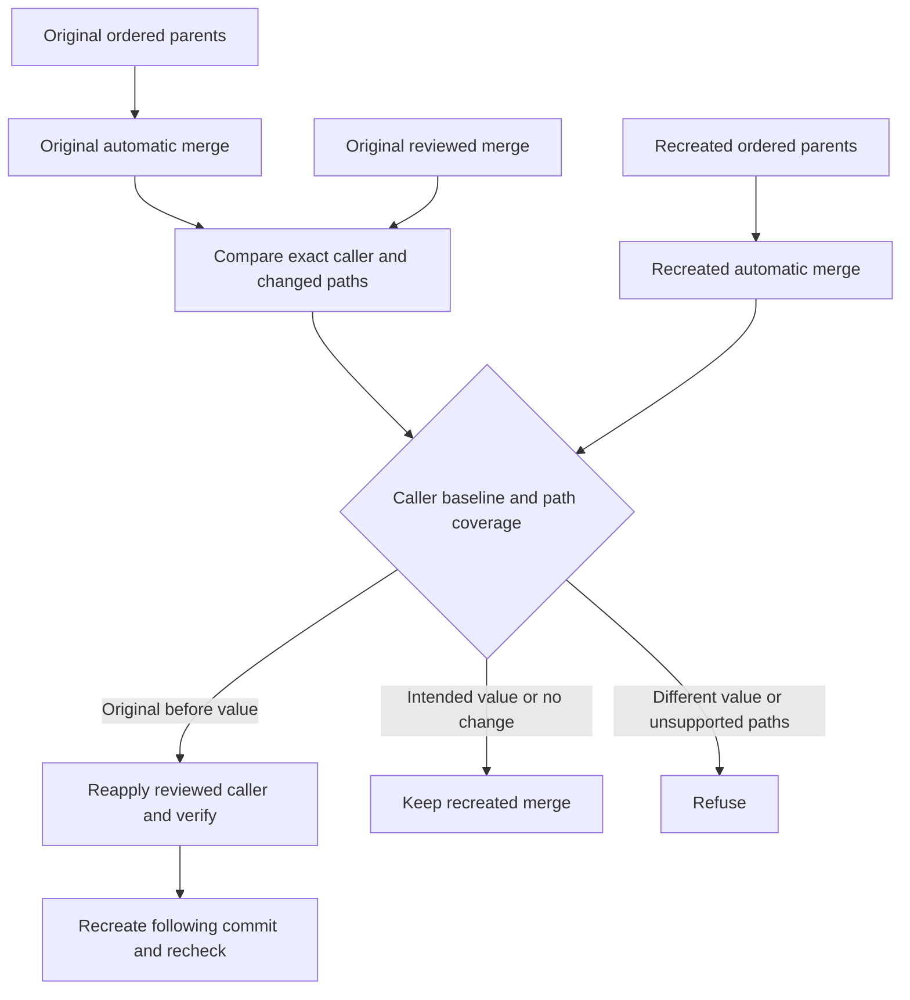

# Preserve reviewed merge-only caller changes across Git rebase

This RT-24 study asks when recreating a two-parent merge preserves a reviewed semantic change made only in that merge. A native rebase can finish cleanly with the expected topology and reconstruct a closed semantic graph, yet replace the reviewed merge's contents with the automatic result for its new parents. Earlier tests covered linear retained histories. [Multi-commit replay prefixes](RT-24-MULTI-COMMIT-REPLAY-PREFIXES-2026-11-24.md)

## Checked reconstruction

The closed inventory declares a contract and three exact compatible provider objects. Its caller binds to one exact hash. Original topic parents add separate ordinary files. Most original merges add a reviewed caller retarget beyond the body of the automatic merge. The experiment calls this difference the merge-only change. In one scenario the commit following the merge restores the original target, leaving the expected final call unchanged. Destination changes include a disjoint ordinary edit, an additional independent declaration and two alternative call bindings.

The native path runs `git rebase --rebase-merges --empty=keep` in each temporary repository. The experiment verifies exact parent shape, extracts original and recreated automatic trees with `git merge-tree --write-tree`, and imports the tracked source blobs into fresh stores. It checks closure and captures the source-audited exact call site. The before/after requirement for a supported merge-only caller change is the complete typed caller hash, including the call target, condition and required contract. A changed unrelated declaration does not alter that caller hash.



The repair path allows only one changed source path containing the exact caller retarget. It accepts an existing exact intended caller idempotently. If the recreated merge still contains the exact before caller, it writes the reviewed after declaration, creates a new commit with the two recreated parent IDs, and checks that the caller path is the only changed one. The experiment replays the original post-merge commit when present and rechecks its tree. A different caller baseline or additional merge-only path requires review and is refused. The temporary branch refs remain pinned throughout.

## Results

Seven histories run on the files and reftable ref backends. Both backends produce equal Git and semantic observations for each history. The closure column counts complete fresh imports. The root equality column compares the old and new tips without taking the destination's new semantic declarations into account. The disposition uses the merge-only caller policy before any publication.

| Source and destination case | Closed rebase | Old terminal root equal | Checked disposition |
|---|---:|---:|---|
| Ordinary destination edit | 2/2 | 0/2 | Reapply checked caller change |
| Later commit restores the old call | 2/2 | 2/2 | Reapply checked caller change |
| Disjoint destination declaration | 2/2 | 0/2 | Reapply checked caller change |
| Destination already has intended call | 2/2 | 2/2 | Accept exact caller |
| Destination has another exact call | 2/2 | 0/2 | Refuse changed caller baseline |
| No merge-only change, disjoint declaration | 2/2 | 0/2 | Accept automatic merge |
| Caller and ordinary merge-only changes | 2/2 | 0/2 | Refuse unsupported paths |

All 14 native candidates finish with a clean checkout, the expected retained merge topology and closed program graphs. Four already satisfy the scoped merge-only gate. Final root equality accepts four, including two restored-terminal cases whose recreated merges lost the reviewed migration. It also rejects both correct no-residual cases when the destination introduces an independent declaration. Inspection of the merge itself distinguishes these cases.

Six candidates are repaired. The rebuilt merge selects the intended exact provider in each. The two restored-terminal repairs keep that intermediate target and replay a following commit that restores the original target. Both disjoint-declaration repairs preserve the added destination declaration. Two competing destination cases and two unsupported mixed-path cases remain refused. No repository ref is published by the fixture.

## Boundaries and replay

The study assumes that the original reviewed merge is available and accepted by the caller. It requires both original and recreated automatic merges to resolve without a textual conflict. There is no check of signer authority, server authorization, generalized caller-impact closure, or multi-merge conflict interaction. A production policy still needs scoped decisions for ordinary merge-only files, analysis of originally conflicted merges, support for multiple changed declarations and merge nodes, and an exact publication transaction. The checked caller rule is a candidate within this closed source inventory.

Use Git 2.52.0 and CPython 3.12.14. The initial LLMLang base is `89995abf3dc01a7154765a0084da339f6fb3e07b`. The runner sets fixture commit metadata and records its source hash, exact Git IDs, source inventory checks, caller hashes and reconstructed semantic roots. Run from the checkout root.

```bash
fixture=research/toolchain-and-collaboration/RT-24/REBASE-MERGE-RESIDUAL-01
PYTHONHASHSEED=1 python3 -B "$fixture/run.py" > /tmp/llmlang-rt24-merge-residual.json
cmp "$fixture/evidence.json" /tmp/llmlang-rt24-merge-residual.json
python3 "$fixture/chart.py"
```

See the [native Git runner](REBASE-MERGE-RESIDUAL-01/run.py), [measured ledger](REBASE-MERGE-RESIDUAL-01/evidence.json), [table generator](REBASE-MERGE-RESIDUAL-01/chart.py), and [RT-24 replay closure study](RT-24-GIT-REPLAY-SOURCE-CLOSURE.md).
