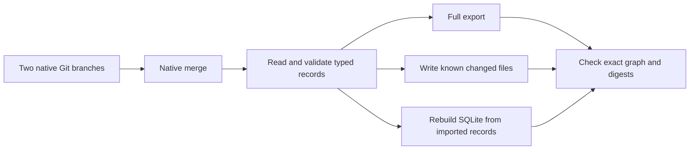
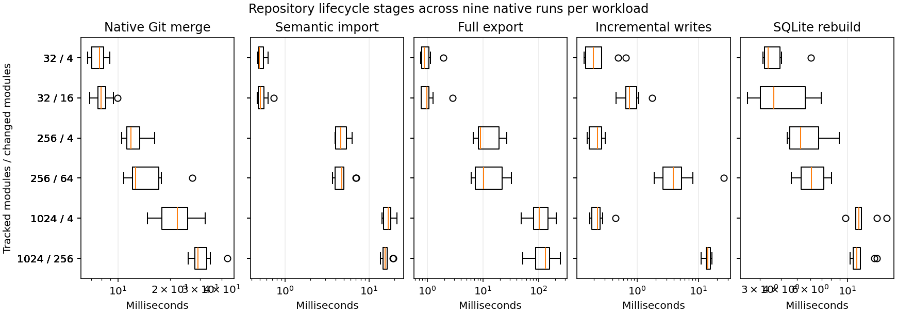

# RT-24 Repository lifecycle stage costs

A repository update incurs several independently measurable costs. This study measures local native Git merge, typed-record import, full export, incremental checkout writes and reconstruction of a fresh SQLite cache. The comparison tests a candidate incremental path for a known changed set. An exact expected graph is built independently from the two edits. Both export destinations must reimport to that same graph, and every reconstructed SQLite row must match the expected payload and digest.



The fixture uses 32, 256 or 1,024 UTF-8 JSON files with fixed scalar types and acyclic dependency edges. Two branches change disjoint groups of provider revisions, creating a clean native merge. No measured step starts a remote operation. Full and incremental export alternate order. Every run creates a fresh repository, but OS caches are uncontrolled. Import reads every declared file and checks its typed edges. Incremental time measures known changed-file writes and excludes changed-set discovery. The fresh SQLite reconstruction includes schema creation and the first transaction. It skips reuse and invalidation of an existing cache.

| Tracked files | Changed files | Git merge | Import | Full export | Incremental writes | SQLite rebuild |
|---:|---:|---:|---:|---:|---:|---:|
| 32 | 4 | 7.802 | 0.495 | 0.878 | 0.195 | 3.354 |
| 32 | 16 | 7.973 | 0.509 | 0.972 | 0.751 | 3.629 |
| 256 | 4 | 11.905 | 4.595 | 8.952 | 0.226 | 5.250 |
| 256 | 64 | 12.629 | 4.713 | 10.121 | 3.900 | 6.113 |
| 1,024 | 4 | 22.115 | 17.057 | 103.215 | 0.226 | 11.695 |
| 1,024 | 256 | 29.051 | 15.534 | 131.691 | 14.285 | 11.406 |

Entries are medians in milliseconds over nine samples per workload, 54 native runs and 270 measured stages overall. At 1,024 tracked files and four edits, incremental writes had a 0.171–0.444 ms range, full export had a 48.771–207.863 ms range, and merge still had a 14.798–32.064 ms range. A known exact changed set saved write time in this setting. Each write path was followed by a full read-back check outside the measured interval. The study supports reporting stage costs separately. It leaves discovery, rich semantic conflicts, power-loss durability, cold filesystem caches and representative LLMLang workload performance open.



The [raw samples](REPOSITORY-LIFECYCLE-COST-01/samples.json) record the runner digest and platform. The environment was Linux 6.18.57 x86-64, glibc 2.41, AMD EPYC 9V74, overlayfs, Git 2.56.1, CPython 3.12.14 and SQLite 3.53.1, using an unpinned shared runner. Repeat runs check the same roots and may produce different timings.

```sh
p=research/toolchain-and-collaboration/RT-24/REPOSITORY-LIFECYCLE-COST-01
LC_ALL=C PYTHONHASHSEED=37 python -B "$p/check.py" > /tmp/llmlang-repository-cost.json
LC_ALL=C MPLBACKEND=Agg MPLCONFIGDIR=/tmp python -B "$p/plot.py"
```

The plot command uses Matplotlib 3.10.8 and the committed samples.
