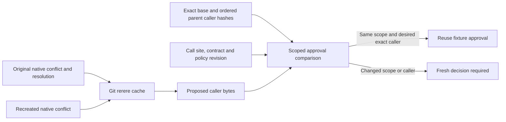

# Scope conflict resolution reuse during Git rebase

This RT-24 experiment compares reusable text resolutions from native Git with the scoped semantic approval of an exact call-site decision. It asks whether a previously resolved conflict preserves the intended binding after a change to parent roles, destination declarations or the decision policy. It covers retained two-parent Git merges that originally required resolution.

## Fixture and decision predicates

A closed program inventory defines three exact provider bodies with one shared contract and a caller initially pinned to the first version. Two branch commits change that call to different exact providers. They conflict in the serialized target hash. A source merge selects the first-parent call under a fixture policy naming an ordered parent role. Git's `rerere` records the original conflict preimage and resolved postimage. The test then recreates a merge on a new destination using `git rebase --rebase-merges`.

The destination always adds ordinary bytes. Other changes add an independent semantic declaration, change the policy's chosen role, or increment the policy revision while retaining its choice. A separate original reviewed merge swaps the parent order and resolves according to its own first-parent rule. A fixture oracle calculates the intended provider from the authored parent roles and destination policy. The actual output is independently imported from Git blobs into a fresh graph with a source-audited exact call site.

Git's automatic staging option determines whether the reused proposal stays in the working tree with unmerged index stages or replaces those stages. Every experiment inspects both the index and working tree at the pause. For measurement the runner manually stages when needed and continues rebase on detached HEAD. No candidate branch is published.



The closure check verifies exact source inventory, types and reachable provider. The whole-parent gate requires all original Git base and ordered parent IDs to remain identical. The scoped gate binds the original and current caller at one exact path and site to the base caller hash, ordered parent caller hashes, required contract and decision-policy digest. It also compares the resolved caller hash to the independently selected one. The test assumes the field set is complete for this fixture policy.

## Results

Five semantic cases cross files and reftable storage and both settings of `rerere.autoupdate`, making 20 histories. Each recreated merge pauses at a native conflict. Git proposes the cached text in every history from a single unchanged preimage/postimage pair. Automatic staging affects the index in 10 cases. All 20 resulting candidate source trees close. The table counts the four executions of each case.

| Rebase case | Fresh exact target | Autostaged | Whole Git parent gate | Scoped approval reuse |
|---|---:|---:|---:|---:|
| Same affected inputs | 4/4 | 2/4 | 0/4 | 4/4 |
| Disjoint declaration added | 4/4 | 2/4 | 0/4 | 4/4 |
| Reviewed branch choice changed | 0/4 | 2/4 | 0/4 | 0/4 |
| Policy revision changed, same choice | 4/4 | 2/4 | 0/4 | 0/4 |
| Ordered parent roles reversed | 0/4 | 2/4 | 0/4 | 0/4 |

The changed-choice and reversed-parent cases produce eight wrong exact targets. The policy-revision cases produce the intended target but lack reusable evidence for the new policy. The whole Git parent gate refuses all 20 because parent IDs change even for unrelated destination edits. The scoped gate reuses eight approvals and requires a new decision in the other 12. The available Git staging switch changes the review surface but leaves the reused bytes and all semantic outcomes unchanged.

## Boundaries and replay

The study models one caller and one exact conflict path in a confined, local repository. The scoped approval is authored fixture data. There is no authentication, signed reviewer identity, unauthorized writer test or proof of complete impact scope for general merges. Text cache lifecycle, multiple paths and sites, explicit authorization for publication, and independent review remain open. Automatic staging is a native workflow choice. Candidate admission needs its own current semantic and approval checks.

Use native Git 2.52.0 and CPython 3.12.14. The initial base is `89995abf3dc01a7154765a0084da339f6fb3e07b`. The ledger records the runner SHA-256, cache image digests, Git objects, exact scope values and source-audited target. Run from the repository root.

```bash
fixture=research/toolchain-and-collaboration/RT-24/RERERE-SCOPE-01
PYTHONHASHSEED=1 python3 -B "$fixture/run.py" > /tmp/llmlang-rt24-rerere-scope.json
cmp "$fixture/evidence.json" /tmp/llmlang-rt24-rerere-scope.json
python3 "$fixture/chart.py"
```

See the [native fixture](RERERE-SCOPE-01/run.py), [measured ledger](RERERE-SCOPE-01/evidence.json), [table generator](RERERE-SCOPE-01/chart.py), and [RT-24 conflict resolution replay](RT-24-CONFLICT-RESOLUTION-REPLAY-2026-11-24.md).
