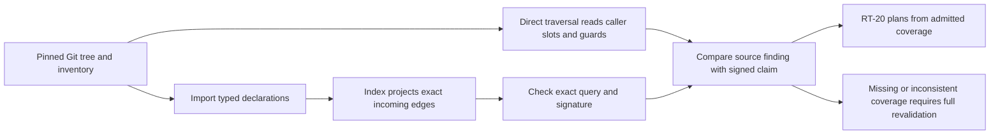

# RT-24 — Audit authority and source replay before caller migration

**Evidence** — Native Git sources, twelve audit conditions and the existing RT-20 impact planner.

## Question and alternatives

A reverse lookup lists the callers that must receive an explicit migration or preservation decision when an implementation changes. The existing dependency-index API binds a completeness claim to a snapshot, target, scope, extractor, schema and edge digest. Those fields agree even when the same incomplete projection supplies both the edge set and its claim. We compare the information the consumer gains from a producer signature and from a distinct source traversal. [RT-24 source inventory](RT-24-MERGED-TREE-SOURCE-COMPLETENESS.md) · [RT-20 and RT-23 publication gate](RT-24-TREE-BOUND-CIP-PUBLICATION.md)

| Policy | Admission requirement | Cost and assumption |
| --- | --- | --- |
| Existing binding check | The result and claim agree on the exact query and the claim says the result is supported | Reuse is cheap. The consumer assumes the supplied claim was justified and authorized elsewhere. |
| Authorized signature | Additionally bind the complete claim, source tree and inventory, and verify against the configured auditor key and observation model | This can support remote producers with locally governed keys. Coverage depends on their observation and on the configured trust policy. |
| Authorized signature and source recheck | Require the previous checks and reproduce the claim from the selected source inventory | In the closed subset, callers dropped by the index are observable from source. Consumer-side source access and traversal are required. The recheck shares the fixture importer and declaration schema. |



The two evidence paths encounter the same typed source from different directions. One constructs the normal index projection. The other enumerates declared call sites and compares both the selected declaration values and edge details. The Ed25519 fixture signs domain, authority, tree, inventory and every claim field, including assumptions, excluded behavior, status and findings. The consumer chooses the public key and approved observation model locally. Fixed public test keys make the ledger reproducible.

## Results

A real tracked caller contains two guarded calls, `fallback/direct` and `invoke/direct`, with exact callee and contract hashes. The control with two missing index edges keeps the source tree and semantic snapshot unchanged. It substitutes only the projection and can issue either an accurate finding or a false claim matching its empty edge set.

| Condition | Binding check admits coverage | Authorized signature admits coverage | Signature and source recheck admit coverage |
| --- | --- | --- | --- |
| Honest source audit | Yes | Yes | Yes |
| No signature, valid signature outside role, wrong key, or withdrawn grant | Yes | No | No |
| Changed assumptions after signing, or signed wrong observation model | Yes | No | No |
| Same semantic root and inventory under a different ordinary-file tree | Yes | No | No |
| Earlier honest claim applied to an empty edge set | No | No | No |
| Authenticated finding of missing caller edges | No | No | No |
| Unsigned false claim matching the empty edge set | Yes | No | No |
| Authorized false claim matching the empty edge set | Yes | Yes | No |

The binding check admits ten of twelve claims. The authorized-signature policy admits two. With source recheck, only the honest scoped claim passes and the planner receives both call sites. In the signed false-claim control, signature-only admission gives the planner no callers and no `FULL_REVALIDATION` action. Source recheck recovers the discrepancy and the gate requires full revalidation. The negative finding survives in the evidence ledger. The planner is asked to assess coverage before migration dispositions, so the honest caller list still requires two decisions before publication.

## Implementation implications

The query binding prevents stale projection replay. A signature adds source and issuer binding, bounded by explicit authorization to make the claim under that model. For explicit calls the consumer can also compare direct source enumeration before relying on an empty or reduced impact set. If later frontends share a hidden omission with the recheck, this comparison can miss it. Reflection, dynamic dispatch, externally generated calls, source coverage under a production parser, key rotation, authorization epoch and the cost of bulk rechecks remain open. This study reads and plans against a bounded Git fixture. The linked RT-24 experiment covers actual exact-tree publication and receipt writes under its own approval inputs. [Publication fixture](RT-24-TREE-BOUND-CIP-PUBLICATION.md) · [Trust and cached evidence](../RT-11/RESEARCH-SCENARIO-93-CACHE-SOUNDNESS-RESULT-ENVELOPES-AND-TRUST.md)

## Reproduction

Run with Git 2.52.0, OpenSSL 3.5.7 and CPython 3.12.14:

```sh
study=research/toolchain-and-collaboration/RT-24/AUDIT-AUTHORITY-01
python3 -B "$study/run.py" --output /tmp/llmlang-audit-authority.json
cmp "$study/evidence.json" /tmp/llmlang-audit-authority.json
(cd research/PROTOTYPES/DEPENDENCY-GRAPH-01 && python3 -B -m unittest \
  tests.test_rt24_tree_bound_cip tests.test_rt24_merge_tree_gate \
  tests.test_semantic_dependency_index tests.test_candidate_semantic_diff_cip_v2)
```

The [executable comparison](AUDIT-AUTHORITY-01/run.py) checks each outcome and the false claim's effect on RT-20. The [ledger](AUDIT-AUTHORITY-01/evidence.json) preserves the signed bodies, public keys, signatures, independent findings and planner observations for all twelve conditions. The table renders these categorical comparisons.
