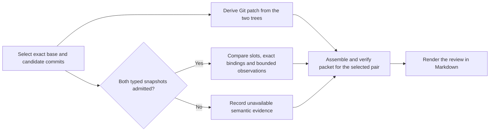

# RT-24 Source and semantic review packets

**Issue** [#336](https://github.com/aivibeflow/LLMLang/issues/336)

A reviewer needs to see what changed in the source, what changed in the admitted program, and which behavioral observations were available for the same revision pair. A patch can be physically different while preserving the typed graph. Equal sample results can also accompany changed typed values. This study defines and generates a small review packet for the [native diff-layer fixture](RT-24-DIFF-OBSERVATION-LAYERS-2026-11-25.md).

## Review workflow

The producer selects an ordered base and candidate commit and resolves both trees. It records the exact Git patch and its digest and requests independent typed graph admission for each side. When admission succeeds, the packet shows changed slots, both typed roots, the exact old and new provider when a binding changes, and the compared results and traces for the declared inputs. When admission fails, the packet retains the patch and explains that semantic comparison and interpreter results are unavailable. An unavailable comparison is visibly different from an admitted graph with no typed changes.

The producer binds the exact tree pair, observation inputs and packet content in a digest. The local verifier independently regenerates the expected packet for the selected pair and compares the structured data. Rendering the resulting packet makes it readable for a Git-oriented reviewer. A pure source review still gives exact bytes and diff context, while a typed-only view lacks physical evidence. The combined packet needs both source-tool and graph-tool availability and increases the volume of information a reviewer sees.



The diagram shows the source and semantic parts of one review packet. The verifier binds them to one revision pair. Review outcomes, author identity and authority to publish would be separate records.

## Example output and checks

The runner generates eight packets from native Git comparisons. All eight match independently regenerated structured data. It rejects a patch copied from a different tree pair, a changed observation scope with a recomputed packet digest, and a valid packet from the wrong candidate. The [ledger](REVIEW-PACKET-01/evidence.json) records packet and rendering hashes and the refused controls. The comparisons are categorical and do not measure reviewer time.

| Reviewer question | Result in the fixture |
| --- | --- |
| Did a documentation or formatting edit change the admitted graph? | The source patch remains visible and the packet reports no typed selection change. |
| Did a binding change alter execution? | The exact binding and provider addresses change, and all five results differ. The event traces remain empty. |
| Does unchanged sample behavior establish an unchanged graph? | The neutral addition changes the entry implementation address and root even though all sample results agree. |
| What if the candidate does not admit? | The packet shows the raw patch and the unknown-provider error, with no semantic diff or candidate observations. |

Two generated documents are retained for direct review. The [provider retarget packet](REVIEW-PACKET-01/retarget-provider.md) includes the changed binding, exact providers and bounded observations. The [invalid provider packet](REVIEW-PACKET-01/invalid-provider.md) shows the admission boundary. Both documents include exact native source patches. The temporary commit objects can be recreated by running the fixture.

The workflow applies to the selected two-provider language profile. It leaves package and external dependencies, cross-slot identity and migration, trustworthy packet transport, rendering of arbitrary repository text, editor integration, human review quality and production approval open. Exact packet correspondence does not certify semantic equivalence or show what a reviewer understood. [Review scope and subsequent changes](RT-24-CHANGESET-REVIEW-SCOPE-2026-11-25.md)

## Reproduction

Use Git 2.52.0 and CPython 3.12.14 at repository root. The runner verifies its Git and graph source pins at `cd4d59dcd8b698e54d5a081b7e31ea958c8f6f03`. Hash seeds 1 and 2 produced identical JSON and Markdown files. Relative links and Mermaid source structure were checked. GitHub visual rendering was not manually verified.

```sh
study=research/toolchain-and-collaboration/RT-24/REVIEW-PACKET-01
out=$(mktemp -d)
PYTHONHASHSEED=1 python -B "$study/run.py" --output-dir "$out" >"$out/evidence.json"
for name in evidence.json retarget-provider.md invalid-provider.md; do
    cmp "$study/$name" "$out/$name"
done
```
