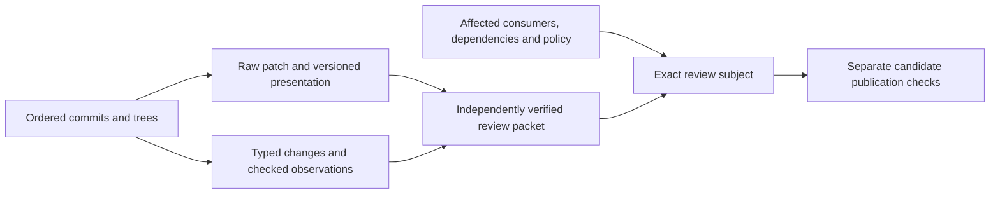

# RT-24 reviewable semantic change sets

A reviewable change set carries an exact source revision pair, raw source patch, typed changes, affected dependencies and a declared observation scope. Presentation can omit formatting noise. An independently verified packet retains the basis for review and shows explicitly when semantic evidence is unavailable.

## Candidate records

| Record | Review purpose |
| --- | --- |
| Ordered commits and trees | Pin the physical inputs and the raw source patch. |
| Typed change projection | Show exact changed slots, before and after values, provider bindings and unaffected scopes when known. |
| Validation and observations | Name the admission status, checked inputs, compared outputs and effects, with explicit unavailable results. |
| Affected scope | Include consumers and upstream facts for each side, along with completeness evidence. |
| Review subject | Bind selected edits, ordered values, dependency scope and policy. A saved result may be reused only when the relevant scope remains exact. |
| Publication decision | Bind all required approvals and validation to the whole candidate independently of any local review result. |



## Reconciled results

The checker pins three independent evidence ledgers. Five native Git projections include two metadata mismatches, one with an empty rendered program patch. The two provider changes share a readable patch while only the freshly generated metadata passes verification. All eight review packets match independent reconstruction. Swapping the source patch, changing the observation scope or substituting the candidate fails the packet check. The invalid-provider packet preserves the raw patch and marks typed evidence unavailable. [Git projections](RT-24-GIT-REVIEW-PROJECTION-2026-11-25.md) · [Review packets](RT-24-REVIEW-PACKET-2026-11-25.md)

Across eleven review contexts, the closed scope retains four exact or unrelated revisions, including documentation edits on either side. A new transitive caller preserves the direct edit subject yet changes the dependency-closed review subject. Real reviewer effectiveness, identity and authority, dynamic dependency discovery and editor integration require different evidence. [Dependency-closed scope](RT-24-CHANGESET-REVIEW-SCOPE-2026-11-25.md)

## Reproduce

CPython 3.12.14 with Python hash seeds 37 and 71 yields evidence SHA-256 `d936363154cba5f76713a74a6a34a904b7cdb047e8b869624e86da44a2b1b3f5`. Each input study has its own original reproduction commands. [Reconciled evidence](REVIEW-PACKET-BOUNDARY-01/evidence.json)

```sh
LC_ALL=C PYTHONHASHSEED=37 PYTHONDONTWRITEBYTECODE=1 \
  python research/toolchain-and-collaboration/RT-24/REVIEW-PACKET-BOUNDARY-01/check.py > /tmp/rt24-review-boundary.json
```
