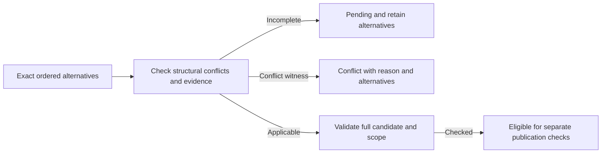

# RT-24 conflict detection and safe automatic resolution

A conservative semantic merge distinguishes a demonstrated conflict, incomplete evidence and eligibility for the exact candidate. A fresh check can resolve a pending case in either direction. Publication remains subject to its own authorization and exact-tree check.

## Candidate decision rules

| Evidence for the ordered base and alternatives | Decision |
| --- | --- |
| Missing, stale, incomplete or ambiguous | Pending. Retain the exact alternatives and restart the missing check on a current scope. |
| Witness of order dependence, failed invariant or unresolved structural conflict | Conflict. Retain the witness and alternatives for resolution or review. |
| Complete applicable independence evidence, valid candidate, complete source inventory and exact reverse coverage | Eligible within the checked profile. Record the candidate and applicable proofs or validation receipts. |
| Saved manual resolution with a changed affected caller or guard | Request a fresh scope decision. An exact local slot match is insufficient. |
| Git merge returns clean | Treat the staged result as a candidate and validate the unified semantic state. |



The policy requires evidence appropriate to the edit class. For the finite commutativity fixture, equal composition on a strict prefix is incomplete. A witnessed difference is sufficient to stop the tested automatic route. This does not exclude all other possible resolution strategies. A later explicit choice can use a separately checked scope. [Conservative finite recheck](RT-24-CONSERVATIVE-MERGE-2026-11-25.md)

## Reconciled observations

The checker validates exact digests for four archived ledgers and extracts the following controls directly from them.

| Source | Verified distinction |
| --- | --- |
| Conservative evidence handling | Four of seven pending cases become eligible when rechecked, and three become conflicts. |
| Native Git fallback | Three clean Git results include two semantically ineligible candidates. The other three Git outcomes retain base, ours and theirs in original conflict stages. |
| Merge admission coverage | Structural validation yields 110 of 165 candidates. Independent source and reverse coverage reduce eligibility to one. |
| Saved conflict resolution | Three cases keep the same apparent slot choice while changing the affected caller, a guard, or alternative retention. Exact affected scope refuses all three saved choices. |

The results support the candidate distinctions in the table and are scoped to the four recorded fixtures. The gate requires a trusted source inventory, explicit profile coverage, and fresh publication authorization. A general automatic resolver for dynamic, generated and incomplete graphs remains open. [Git fallback](RT-24-MERGE-FALLBACK-ADMISSION-2026-11-25.md) · [Coverage check](RT-24-MERGE-ADMISSION-COVERAGE-2026-11-25.md) · [Resolution replay](RT-24-CONFLICT-RESOLUTION-REPLAY-2026-11-24.md)

## Reproduce the reconciliation

CPython 3.12.14 with Python hash seeds 37 and 71 produces evidence SHA-256 `ceea863053be8c9ce41a295c142cdde48f7854a88b9d36f60c1f9cee03ef964d`. The input ledgers contain the independent runners and their original reproduction conditions. [Evidence reconciliation](MERGE-RESOLUTION-BOUNDARY-01/evidence.json)

```sh
LC_ALL=C PYTHONHASHSEED=37 PYTHONDONTWRITEBYTECODE=1 \
  python research/toolchain-and-collaboration/RT-24/MERGE-RESOLUTION-BOUNDARY-01/check.py > /tmp/rt24-resolution-boundary.json
```
