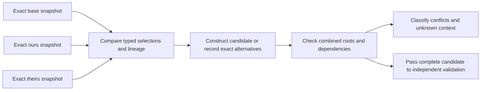

# RT-24 semantic diff, three-way graphs and conflict classification

A text diff locates changed bytes. An AST diff locates changed syntax. Neither can establish which exact provider a typed snapshot binds after a catalog edit. This candidate defines semantic diff and a finite three-way graph merge, then checks how known conflicts and incomplete context should be represented. It reconciles four exact prior ledgers.

## Semantic delta

Read both exact selected and independently admitted semantic snapshots. Identify managed occurrences by typed selection and explicit lineage. For each changed occurrence, record old and new immutable values, typed references, exact required/provided contracts, provider selections and cause or scope. Preserve distinction among addition, removal, continuation, replacement, split and merge. A side mapping can report source, provenance and presentation changes without assigning them executable meaning. A separate bounded observation comparison can detect altered values and effects. Equal output on sampled inputs cannot by itself establish semantic equality.

The [layered diff](RT-24-DIFF-OBSERVATION-LAYERS-2026-11-25.md) checks eight candidates. Equivalent surface forms can change while keeping typed addresses. A provider retarget changes meaning with the entry syntax fixed. Adding zero can change typed structure while preserving the five observed results. One invalid binding refuses admission.

## Three-way candidate

Pin the exact merge base and both sides together with policy and selected entrypoints. Validate the source inventories, closure, typed declarations and current selections before forming a candidate. For an existing occurrence, keep the side that changes while the other retains the base. Equal changes to the same lifetime can converge. Divergent changes require a conflict or a separately proved composition. Independently introduced selections at one logical key need explicit lineage even if their payloads match. Analyze deletion, new references, exact bindings and roots in the complete candidate. Do not mutate the input snapshots while proposing a candidate.



The [pure merge core](RT-24-PURE-MERGE-CORE-2026-11-25.md) compares 4,096 two-slot cases with an independent oracle. It gives 1,369 structural candidates and 2,727 conflicts. Swapping the two sides preserves candidate selection or exchanges the exact conflict versions without mutating the store. Target-edge and missing-dependency controls check additional typed cases. The single-base fixture cannot determine a correct policy for ambiguous merge ancestry.

## Typed conflict classes

| Finding | Conflict payload and consequence |
|---|---|
| Same-node divergent update or delete/update | Stable occurrence and exact base/ours/theirs values or tombstones. Preserve both alternatives |
| Contract/implementation divergence | Exact required and provided contracts, selected body and missing or refuting combined evidence |
| Identity collision | Namespace, slot, causal lifetime evidence and both selected identities. Equal bytes do not disambiguate independent allocation |
| Dependency conflict | Exact target occurrence, required scope and missing, rebound or incompatible target |
| Split/merge conflict | Exact competing many-to-one or one-to-many lineage and affected per-caller receipts |
| Metadata-only conflict | Exact conflicting metadata and its declared scope. A report or policy record can still block promotion even when executable semantics agree |

Independent C contract and body changes yield 32 clean native merges, yet seven of 16 combined pairs fail the joint contract. The [lineage comparison](RT-24-IDENTITY-LINEAGE-AND-REBIND-2026-11-25.md) further requires distinct receipts for affected callers after split and merge. These show why file separation and two valid parents cannot prove the combined result. [Contract/body comparison](RT-24-CONTRACT-BODY-MERGES-2026-11-25.md)

The new classifier crosses all subsets of six findings with complete or incomplete context for 128 cases. It records 124 known semantic conflicts, two insufficient-context results, one complete metadata conflict and one complete structural candidate. A known semantic conflict remains recorded even if other checks are unavailable. Incomplete scope with no known semantic conflict withholds a clean result. Input finding order does not change the normalized classification. This is a precedence check over supplied findings. It does not establish a general conflict detector.

A file-based merge is a useful transport operation. It cannot validate the selected typed program without resolving exact references and checked dependencies. A full semantic merge costs more typed context. It preserves actionable subject, cause and alternative information when independent composition remains unknown.

## Verify and limits

The [checker](SEMANTIC-MERGE-CLASSIFICATION-01/check.py) and [ledger](SEMANTIC-MERGE-CLASSIFICATION-01/evidence.json) use Git 2.56.1 and CPython 3.12.14 with four archived ledgers at `aeebb503a2852833632b82f31bc393d1c0652a3b`. Hash seeds 37 and 71 give identical outcomes. The checks preserve the pinned native evidence without rerunning the underlying builds.

```bash
fixture=research/toolchain-and-collaboration/RT-24/SEMANTIC-MERGE-CLASSIFICATION-01
PYTHONHASHSEED=37 python3 -B "$fixture/check.py" > /tmp/llmlang-merge-classes.json
cmp "$fixture/evidence.json" /tmp/llmlang-merge-classes.json
```

The candidate requires a separately admitted full source inventory, other types of declarations and effects, certified lineage, and post-merge contract and proof validation before production publication.
