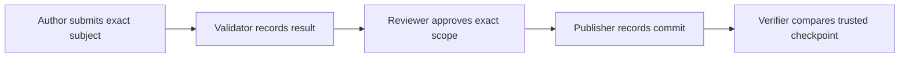

# RT-24 authorship, validation, approval and audit continuity

An audit trail can retain distinct signed records for submission, validation, approval and publication. Each record binds the exact candidate, review scope, policy epoch, event type and predecessor. The fixture accepts one complete four-event history and refuses nine alternate histories.

## Candidate records

| Role | Signed event | Meaning |
| --- | --- | --- |
| Author | Submission | Attributes a proposed change to a configured author key. |
| Validator | Verification | Binds the configured validator's result to the exact candidate and scope. |
| Reviewer | Approval | Records a review disposition under the current policy. A signed refusal cannot support the approved route. |
| Publisher | Publication receipt | Records exact committed subject and links it to the approved history. |

The checker uses independent public-key bindings for the four roles and an externally supplied checkpoint for the final event. It reads the records in order, compares their typed subjects and predecessor links, verifies Ed25519 signatures and compares the resulting tail with the checkpoint. Each fixture record is an assertion. Actual source correspondence, validator adequacy and publication remain separate checks. [Exact review scope](RT-24-REVIEWABLE-CHANGESET-2026-11-25.md) · [Audit authority and source recheck](RT-24-REVERSE-AUDIT-AUTHORITY-2026-11-24.md)



## Results

OpenSSL verifies the complete four-record sequence. The negative controls omit review, swap review and validation, sign the review with the author key, bind approval to another scope, submit a signed refusal, change policy epoch, substitute the candidate, break the predecessor link or use a different checkpoint. All nine are refused. A role signature can be authentic for its statement while the history still fails current scope or disposition.

The fixture uses synthetic subjects and temporary keys. It does not model trusted checkpoint distribution, concurrent append, key rotation, authenticated Git authorship, source reconstruction or authorization to change a real repository. The publication event precedes no real external effect in this fixture.

## Reproduce

Use CPython 3.12.14 and OpenSSL 3.5.7. Temporary keys and signatures are excluded from the deterministic receipt, which records payload identities and verification outcomes. Python hash seeds 37 and 71 produce evidence SHA-256 `f8a86421321e832f35a00345556c58c173668aef4e442aa9761e7f299f1610ce`. [Evidence ledger](AUDIT-CHAIN-01/evidence.json)

```sh
LC_ALL=C PYTHONHASHSEED=37 PYTHONDONTWRITEBYTECODE=1 \
  python research/toolchain-and-collaboration/RT-24/AUDIT-CHAIN-01/check.py > /tmp/rt24-audit-chain.json
```
