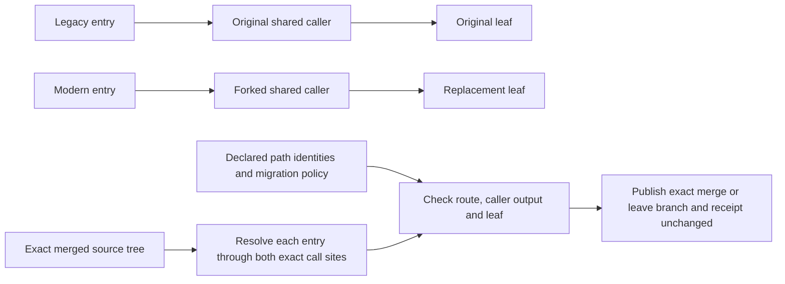

# RT-24/20 — Bind a shared-caller split to exact consumer paths

The existing exact-tree publication gate accepted four fixture plans whose consumer-path claims or routing disagreed with the declared migration. A separate source check blocked those plans and preserved publication, retry and clone reconstruction for the aligned plan.

## Question and method

When two entry points share a caller, a provider replacement can require one branch of the call chain to keep its old provider while the other migrates. The change impact plan (CIP) describes the outcome through exact call-site decisions and caller outputs labeled with consumer paths. The existing publication gate checks captured roots and source inventory, exact discovered call sites, declared output identities, edge changes, and Git tree and commit identity. This study asks whether that is sufficient to verify the relationship between path labels and the source routes. [Exact-tree CIP publication](RT-24-TREE-BOUND-CIP-PUBLICATION.md)

The pinned migration policy keeps the original leaf for the legacy entry and selects the replacement leaf for the modern entry. Both routes have two direct calls. The original shared caller is retained under a new selection key with its old leaf, and its fork selects the replacement leaf. A native two-parent Git merge combines the split with an approved ordinary file change on the other branch. Each configuration runs in two isolated, byte-equivalent repositories so the existing gate and the extended gate attempt publication independently.



The additional gate resolves each named entry through tracked declaration rows in the baseline and candidate. It compares the resolved caller and leaf with the per-path decision, checks that each rewritten upper call labels the same entry, and verifies the provider selection required by the fixture policy. All cases are valid closed source graphs. In the reversed routing case, the supplied exact plan matches the candidate's physical edge edits. Its provider assignments conflict with the declared migration.

## Results

| Case | Closed source and exact CIP gate | With source route check | Route findings |
| --- | --- | --- | ---: |
| aligned | published | published | 0 |
| foreign-path-label | published | blocked | 3 |
| reversed-routing | published | blocked | 2 |
| swapped-path-labels | published | blocked | 3 |
| upper-label-only | published | blocked | 1 |

Four cases share one exact merge commit and have distinct CIP IDs. These controls relabel the two paths, substitute an unknown path, or change only the rewritten upper-call label while keeping the graph intact. The fifth case reverses which consumer migrates. The ledger records exact trees, roots, decisions, path labels and diagnosed discrepancies. Each rejected extended-gate run preserves the expected branch tip with no publication receipt. The aligned run publishes the exact commit, retries to the same result, and reconstructs both routes and the exact semantic root from a clean non-local Git clone.

## Implementation boundary

The result supports binding a declared path to its source entry, each traversed call occurrence, and the approved terminal selection. Local output labels and matching edge diffs are compatible with multiple interpretations of the migration. Exact tree binding still secures the physical publication after the source and plan agree.

The experiment covers two explicit acyclic routes with one fixed migration policy. Compatibility evidence is supplied by the fixture. A general gate needs path completeness over branching and dynamic targets, a policy for recursive paths, independent extraction, authoritative migration decisions and production synchronization with mapping revisions and worktrees. The implementation selection remains open.

## Reproduce

Use CPython 3.12.14 and Git 2.52.0 from the repository root.

```sh
fixture=research/toolchain-and-collaboration/RT-24/SPLIT-CALLER-PATHS-01
output=$(mktemp)
python3 "$fixture/run.py" --output "$output"
cmp "$fixture/evidence.json" "$output"
python3 "$fixture/chart.py"
```

[Runner](SPLIT-CALLER-PATHS-01/run.py) · [Evidence ledger](SPLIT-CALLER-PATHS-01/evidence.json) · [RT-20 impact planning](../RT-20/RT-20-LLM-PATCH-PLANNING-AND-HASH-PROPAGATION.md)
