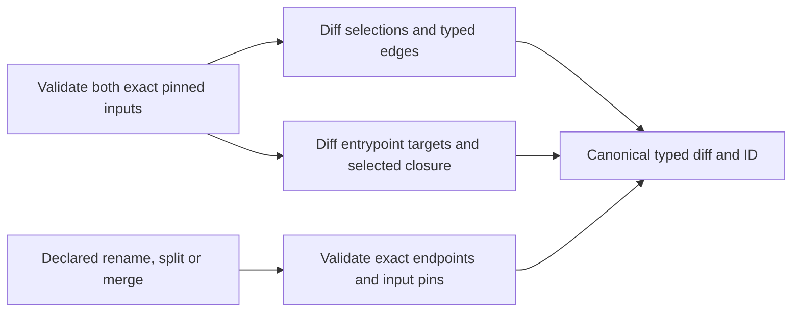

# RT-24. Typed diff of exact semantic inventories

The prototype computes an ordered diff between two pinned, closed semantic inventories. It validates both exact pins, entrypoint mappings and dependency closures before reporting changes. The result identifies selections, references, individual call alternatives, entrypoint targets, added and removed values and supplied lineage. A rejected comparison carries errors and no diff ID. [Issue #321](https://github.com/aivibeflow/LLMLang/issues/321) · [Earlier Git tree diff](RT-24-TYPED-TREE-DIFF.md) · [Closed merge input](RT-24-PURE-MERGE-CORE-2026-11-25.md)

Edge comparison pairs declarations only under the same selection slot, declaration ID and kind. Each edge delta carries both old and new relations, target hashes, conditions and required contracts where applicable. A replacement of the declared identity yields removals and additions without inferring continuity. Entrypoints retain both the selected slot and the exact object it selects. The diff ID binds the ordered input pins and the canonical form of all reported changes.



## Results

The fixture yields nine selection changes, three edge changes, two entrypoint changes, four added and four removed exact values and three supplied lineage records. The comparison distinguishes a call retarget, a condition and required-contract change on another alternative, and a typed dependency retarget. One entrypoint keeps its slot while its object changes. A second entrypoint moves between slots selecting the same object. These remain different changes. [Diff and controls](TYPED-SEMANTIC-DIFF-01/evidence.json)

All 48 lineage-order and endpoint-order replays produce the same diff. Reversing the input pair without lineage swaps both directions throughout the diff and changes its ID. The same snapshot pair with and without supplied lineage also has different IDs. Equal values at two slots leave lineage unresolved unless an explicit record binds their respective endpoints.

Six rejection controls cover stale lineage pins, a wrong endpoint hash, invalid lineage cardinality, an invalid input pin, a missing selected dependency and an unsupported context. A separate identity-replacement control reports both call alternatives as removed and added rather than rewriting them across a new declaration identity. The 26 existing Git-tree and candidate-diff tests still pass.

The implementation validates the shape, exact endpoints and snapshots of supplied lineage. Authority for lineage claims, determining actual continuity, arbitrary source import, dynamic dependency completeness and behavioral compatibility remain outside the prototype.

## Replay

Source baseline `ed439c0` on `research/all`. Replay used CPython 3.12.14 and Git 2.56.1 on Linux. Run from the repository root.

```sh
data=research/toolchain-and-collaboration/RT-24/TYPED-SEMANTIC-DIFF-01
receipt=$(mktemp)
python -B "$data/run.py" "$receipt"
cmp "$data/evidence.json" "$receipt"
rm "$receipt"
```
