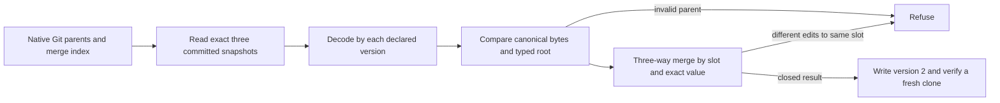

# Merge Git histories across versioned I64 encodings

The proposed RT-24 repository contract requires deterministic import/export across named schema versions. The RT-05 native experiment showed that exact signed values can travel through several encodings and that ordinary JavaScript number parsing can change an input before graph hashing. This experiment asks how a Git three-way coordinator behaves when a format migration overlaps a semantic edit and each parent carries its own asserted typed graph root. [RT-24 candidate contract](RT-24-CANONICAL-SEMANTIC-REPRESENTATION-DIFF-AND-MERGE.md) · [RT-05 cross-runtime encoding](../../semantic-representation/RT-05/RT-05-CROSS-RUNTIME-I64-ENCODING-2026-11-25.md)

## Candidate representations and merge

Each snapshot has a canonical JSON envelope containing a version, two fixed named `I64` slots and a claimed SHA-256 root. Version 1 uses bare decimal JSON tokens. Version 2 uses quoted lowercase hexadecimal for exactly eight signed big-endian octets. The typed root hashes a domain tag and each fixed slot name and exact octets in declared order. A transport-only upgrade changes the Git blob and wire digest while preserving that root. The graph is closed by construction and has no dependency edges. Its fixed selectors let the semantic merge compare corresponding slots without inferring lineage.

The runner commits three snapshots to real parent objects, executes Git's regular three-way merge with a pinned base, and checks the resulting index stages. A separate prototype imports the exact three committed blobs and merges the typed values. A one-side edit wins over an unchanged twin, equal edits coalesce, and differing edits to the same slot conflict. Each successful proposal is materialized as a local version-2 two-parent commit. A fresh clone checks both parents, the committed bytes, the typed root and Git object integrity. Python and Node run separate reconstruction paths for every resulting clone. The experiment performs no external publication.



The four policies compare a hard break to version 2, a dual reader that consumes version-1 values as JavaScript `Number`, an exact dual reader that trusts roots without rechecking them, and an exact dual reader that binds the declared version to canonical input and recomputes every root. The numeric reader also accepts noncanonical spellings. The exact version-1 reader reconstructs the value from the original token with Node's JSON reviver source context. Old clients that only read version 1 require a migration compatibility window or must refuse version 2. The fixture exercises an upgraded coordinator reading historical commits.

## Native observations

The twelve histories include six with a unique expected result and six designated refusals. Native Git reports eleven textual conflicts and one clean result. Four policies over twelve histories give 48 decisions and 144 input observations. All 21 candidate artifacts were reconstructed from a clean clone, including six invalid proposals. An invalid candidate is either a wrong typed result or a commit derived from a parent that the fixture requires the coordinator to refuse.

| Admission policy | Correct candidates | Valid histories refused | Invalid candidates | Expected refusals |
|---|---:|---:|---:|---:|
| Version 2 only with root check | 1 | 5 | 0 | 6 |
| Dual read through JavaScript Number | 2 | 3 | 4 | 3 |
| Exact dual read without root check | 6 | 0 | 2 | 4 |
| Exact dual read with root check | 6 | 0 | 0 | 6 |

In the clean legacy-only history, the `Number` reader produced `9007199254740992` where the committed legacy token meant `9007199254740993`. A signed-limit case rounds the maximum upward and then fails the range check. A pure format upgrade and a disjoint semantic edit merge despite native text conflict. Exact decoding also coalesces equal changes across versions. The two invalid candidates from exact unbound decoding use a stale claimed root, including a canonical legacy snapshot whose bytes contain an already-rounded value. Canonical syntax alone cannot establish that the value matches the claimed graph.

## Scope and reproduction

The bounded results support separate version, transport and typed identity checks for a storage-only migration. Version-2-only admission avoids maintaining a legacy parser and refuses five valid histories here. Exact dual admission preserves those histories and adds code and validation rules for every supported historical representation. A version that changes semantics requires an explicit conversion and compatibility policy. The unsigned in-snapshot root only checks consistency, so a writer who changes both value and root still creates a self-consistent new snapshot. Evidence authority, multi-file graph closure, compatibility across language semantics, production publication, older reader deployment and independent review remain open.

Replay with CPython 3.12.14, Git 2.52.0, Node 22.23.5 and V8 12.4.254.21-node.57. The initial LLMLang base is `0c1a8ce3166fb62ddfa70fb302407fb1c4eff0ab`. The runner creates temporary repositories with fixed dates and isolated Git configuration, captures the exact parent bytes and records every candidate ID and refusal.

```bash
fixture=research/toolchain-and-collaboration/RT-24/VERSIONED-I64-MERGE-01
PYTHONHASHSEED=1 python3 -B "$fixture/run.py" > /tmp/llmlang-versioned-i64-merge.json
cmp "$fixture/evidence.json" /tmp/llmlang-versioned-i64-merge.json
python3 "$fixture/chart.py"
```

[Native histories and clone checks](VERSIONED-I64-MERGE-01/run.py) · [Node reader](VERSIONED-I64-MERGE-01/read.js) · [Observation ledger](VERSIONED-I64-MERGE-01/evidence.json) · [Table generator](VERSIONED-I64-MERGE-01/chart.py)
