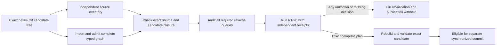

# RT-24 whole-graph source coverage and RT-20 merge admission

A typed merge can be internally closed and still omit a source caller. It can also contain the caller while failing to provide a complete reverse view or an applicable migration decision. This study composes the existing merge core, source inventory gate, reverse query and RT-20 planner. The finite comparison tests how uncertainty moves from the independent source result into the merge coordinator.

## Exact integration

1. Pin the complete base/ours/theirs trees, the current import profile and the selected candidate. Independently decode the committed source inventory, derive its expected typed declarations and check that the reconstructed exact source table agrees with the candidate. A source receipt over the same partial projection cannot establish completeness.
2. Enumerate the required reverse-query targets from both old and new selections and the affected declarations. Independently check exact source occurrences, extraction/schema, scope, snapshot, target and edge digests. Keep the admitted roster in the candidate request. A missing query, omitted alternative or unknown indirect target requires conservative widening or a refusal.
3. Accept an audit only from a currently allowed producer whose observation scope and tool and key revisions match. Authentication protects the identity of the claim. An independently regenerated source or proof establishes coverage in the supported profile.
4. Feed exact checked incoming edges into the RT-20 planner. Preserve, migrate, adapt or fork each affected caller at the exact target and contract, including distinct consumer paths. Rebuild after approved planned and hash-propagated changes and reconcile the final typed graph, source inventory, tests and evidence before selection.
5. Withhold publication if the plan still requires full revalidation, its caller roster is incomplete, or the exact tree differs. Revalidate expected Git and Toolchain state under the separate synchronized-commit gate.



## Checked composition

The new [checker](SOURCE-REVERSE-CIP-GATE-01/check.py) builds the selected candidate with the existing pure merge core. It obtains the exact incoming roster and uses the independent declaration-payload scan. It passes the admitted result through the actual `query_snapshot_incoming`, `audit_snapshot_incoming` and `plan_impact` APIs. This local comparison calculates a preserve decision for the old exact provider in the already merged snapshot. The fixture authority flag represents prior producer verification. It does not authenticate a deployed producer or create a new native commit.

The 16 combinations cross source coverage, current or stale reverse binding, available or missing issuer authority and present or absent exact caller decision. One complete case is eligible. Eight are withheld on source evidence. Six invoke full revalidation for reverse scope or authority and one more invokes it because the required caller decision is absent. Exact plan IDs are recorded for all cases.

The prior [coverage matrix](RT-24-MERGE-ADMISSION-COVERAGE-2026-11-25.md) admits one of 165 cases, with three axiom-free Lean omission statements. An independent source check distinguishes a still-closed but incomplete projection that self-issued evidence would incorrectly accept. The [authority comparison](RT-24-REVERSE-AUDIT-AUTHORITY-2026-11-24.md) checks 12 cases with Ed25519 signatures and a separate source scan. It observes that a signed empty claim alone can suppress required revalidation. The [native CIP coordinator](RT-24-CIP-COORDINATOR-2026-11-25.md) compares 12 Git candidates and publishes only the exact original and separately rebuilt, reapproved requests. It covers all four preserve/migrate/adapt/fork decisions in a closed source fixture. These scopes explain why whole-graph admission requires both independent coverage and an exact plan.

A merge based on stored reverse rows alone has narrower scope and can overlook a missing caller. Searching all historical rows can add unrelated obligations. The candidate binds coverage to an explicit auditable source and selection and preserves fallback when completeness cannot be checked.

## Verify and limits

The [ledger](SOURCE-REVERSE-CIP-GATE-01/evidence.json) records the original archive and current fixture source hashes at `71dc00a9d5b3c80367955d0914a7ae690ee6b812`. The executable check uses CPython 3.12.14 and Git 2.56.1. Both hash seeds reproduce the same counts and IDs.

```bash
fixture=research/toolchain-and-collaboration/RT-24/SOURCE-REVERSE-CIP-GATE-01
LC_ALL=C PYTHONHASHSEED=37 python3 -B "$fixture/check.py" > /tmp/llmlang-source-reverse-cip.json
cmp "$fixture/evidence.json" /tmp/llmlang-source-reverse-cip.json
```

General source and dynamic-call completeness, production auditor authorization and transactionally integrated publication remain open. The checked model withholds a suitable clean disposition if any required closure or caller evidence is unavailable.
