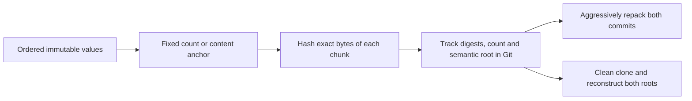

# RT-27 — Fixed and content-defined chunk boundaries in Git

Content-defined boundaries localized unaligned insertion and deletion in the tested immutable record history. Fixed boundaries wrote fewer new payload bytes on a block-aligned insertion and on a same-position replacement. When the records supplied no content anchors, both layouts rewrote the entire active chunk payload.

## Method

The [earlier shard comparison](RT-27-SHARDED-GIT-HISTORY-2026-11-24.md) groups records by stable modules or hash prefixes, or appends immutable segments. This study compares two ways to divide a stable logical sequence into chunks. A chunk concatenates canonical rows in increasing logical slot order. Each row includes its slot, immutable value address and payload. The physical chunk's filename is the SHA-256 digest of its full bytes. A tracked manifest gives the ordered chunk digests, record count and expected semantic root. Both layouts use this same filename and manifest scheme.

| Layout | Boundary rule |
| --- | --- |
| Fixed | End every full chunk after 64 records. |
| Content-defined | Starting at record 24 of a chunk, end at the first record whose value address starts with a 16-bit integer below 1,365. Force a boundary at 128 records. |

The final chunk can be shorter in either layout. The anchor test accepts roughly one in 48 possible prefixes. Its minimum and cap produce 67 chunks for the ordinary 4,096-record baseline, close to the fixed layout's 64. The same deterministic variable-size payload generator drives both layouts. The ordinary cases insert a record near the beginning, delete one in the middle, replace one value at the same rank, or insert exactly 64 records immediately after the first fixed chunk. A separate stress control uses identical input slots but varies the values to avoid every anchor.



Each of ten disposable SHA-1 repositories records a baseline and edited commit. The runner counts reused chunks by digest and totals newly present chunk bytes before packing. It records actual pack and index sizes after the same Git 2.52.0 aggressive collection, with one packing thread, compression level 6, window 10 and depth 50. It also records counts, sizes and maximum observed depths of delta entries from `git verify-pack -v`. New chunk bytes measure full new blob payloads and exclude the manifest. Pack and index totals include the complete two-commit history and metadata.

## Results

| Edit | Boundary | Reused / original chunks | New chunk bytes | Pack + index bytes |
| --- | --- | ---: | ---: | ---: |
| aligned-insert | content-defined | 65/67 | 55,939 | 386,166 |
| aligned-insert | fixed | 64/64 | 22,038 | 379,548 |
| anchor-free-insert | content-defined | 0/32 | 1,432,443 | 684,771 |
| anchor-free-insert | fixed | 0/64 | 1,432,443 | 684,792 |
| early-insert | content-defined | 66/67 | 18,933 | 378,935 |
| early-insert | fixed | 0/64 | 1,432,821 | 707,710 |
| middle-delete | content-defined | 66/67 | 27,194 | 380,928 |
| middle-delete | fixed | 32/64 | 714,764 | 529,486 |
| same-rank-replace | content-defined | 66/67 | 36,895 | 374,105 |
| same-rank-replace | fixed | 63/64 | 22,558 | 379,551 |

The early insertion shifts the fixed segmentation throughout the sequence. An ordinary content anchor reestablishes the previous content-defined boundary. Fixed chunking preserves every old chunk for the aligned insertion, and writes just the added block. At the same-rank replacement both layouts replace one chunk. The fixed layout writes fewer new payload bytes in that case, and the content-defined layout produces a smaller total pack and index. Without anchors, the content-defined layout behaves as fixed 128-record chunks. The early insertion then shifts every boundary, and the history sizes of the two layouts differ by only 21 bytes.

All histories pass `git fsck --full` in the source and in a clean non-local clone. Readers reconstruct matching roots for both revisions by checking chunk digests, strict slot order, value addresses, total count and semantic root. Both layouts reject reordered manifests and altered chunk bytes in the early-insertion control.

## Implementation boundary

A content-defined layout is a candidate when frequent unaligned changes dominate physical update cost. A fixed boundary can favor aligned batches and direct calculation of expected chunk rank. The anchor-free control establishes a case where bounding chunk length alone gives no bound on how many boundaries an insertion shifts. This comparison addresses deterministic blob reuse and history bytes. It leaves long and divergent histories, representative payloads and references, CPU, memory, range reads, checkout and reconstruction times, cache integration and format selection open.

## Reproduce

From the repository root with CPython 3.12.14 and Git 2.52.0:

```sh
fixture=research/toolchain-and-collaboration/RT-27/CHUNK-BOUNDARIES-01
output=$(mktemp)
python3 "$fixture/run.py" --output "$output"
cmp "$fixture/evidence.json" "$output"
python3 "$fixture/chart.py"
```

[Runner](CHUNK-BOUNDARIES-01/run.py) · [Evidence ledger](CHUNK-BOUNDARIES-01/evidence.json) · [Storage requirements](RT-27-SPG-REPOSITORY-STORAGE-FORMAT-REQUIREMENTS.md)
