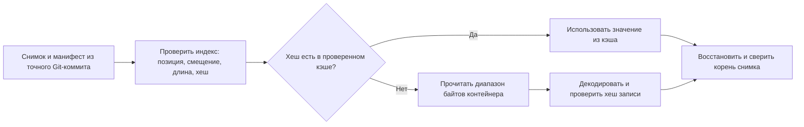
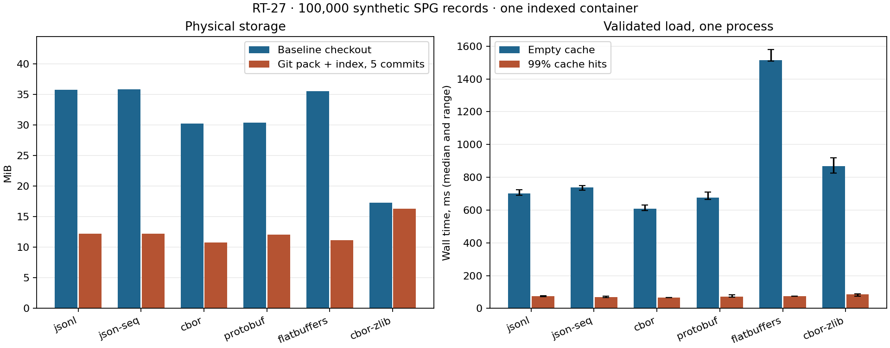

# RT-27 — Сравнение форматов дампа SPG в Git

- **Статус** — измерения на синтетическом корпусе и основание для выбора прототипа. Решение о производственном формате открыто.
- **Контекст репозитория** — `3fcbcc66202c807d87b473bfda748ff04dfb163b`.
- **Область** — канонический импорт и экспорт в Git, отдельно от JSON для обмена через MCP.
- **Дополнительный эксперимент** — [LZ4 на каждую запись](RT-27-DUMP-FORMAT-LZ4.md).
- **Единица сравнения** — одна кодировка записей в одном контейнере с индексом. Сравнения раскладок остаются в отдельных опытах RT-27.

## Вопрос и критерии

Какую комбинацию кодировки, контейнера и индекса выбрать для первого восстановимого дампа SPG? SPG — семантический граф программы. Снимок здесь состоит из логических позиций, значений и ссылок на позиции. Контейнер объединяет все записи снимка в одном файле. Индекс указывает диапазон байтов записи внутри файла.

Вариант сначала должен восстановить тот же граф из Git с пустым кэшем, повторно записать тот же дамп побайтно, обработать неполный кэш без чтения записей, уже найденных в кэше, и отвергнуть несогласованные данные. Затем сравниваем объём checkout, историю Git, восстановление, адресное чтение и пользу параллельного чтения. Проверка семантического слияния относится к отдельному прототипу. [Требования RT-27](RT-27-SPG-REPOSITORY-STORAGE-FORMAT-REQUIREMENTS.md) · [Семантическое слияние RT-24](../RT-24/RT-24-CANONICAL-SEMANTIC-REPRESENTATION-DIFF-AND-MERGE.md)

## Сравниваемые конструкции

Все варианты используют один файл записей и отдельный двоичный индекс. Записи упорядочены по логической позиции. Строка индекса содержит позицию, смещение, длину и SHA-256 логического значения, всего 52 байта. В Git также хранится манифест с хешем индекса, размером файла записей и корнем снимка. Это один конкретный дизайн RT-27. Хеши синтетического корпуса вычисляются по одинаковому логическому представлению для всех кодеков. Профиль хеширования LLMLang остаётся отдельным вопросом.

| Вариант | Кодирование записи | Значимый для выбора компромисс |
|---|---|---|
| JSONL | Именованные поля, UTF-8, одна JSON-запись с LF | Стандартные JSON-инструменты читают отдельную запись. Большие целые представлены десятичной строкой, чтобы точность сохранялась и в типичных JSON-клиентах. |
| JSON Text Sequences | Тот же JSON плюс RS перед каждой записью и LF после | Явный маркер начала по RFC 7464. В опытном индексированном контейнере длина записи дополнительно известна из индекса. |
| CBOR | Детерминированный позиционный массив из пяти полей | Нативный `I64` и компактное представление. Для эволюции позиционной схемы потребуется явно определить правила версий. |
| Protobuf | Типизированные поля с номерами, `sint64` и упакованные ссылки | Схема даёт именованные поля на уровне API и типизированные записи. Для LLMLang отдельно нужны профиль детерминизма и политика неизвестных полей. |
| FlatBuffers | Схема таблицы с нативным `I64` и вектором ссылок | Позволяет обращаться к отдельным полям. Здесь измеряется полное чтение и каноническая проверка, поэтому преимущество выборочного чтения полей не измерено. |
| CBOR + zlib | Тот же CBOR в отдельном потоке zlib на запись, уровень 6 | Доступ по индексу и независимое распаковывание сохраняются. Сжатие добавляет работу приложению и меняет байты, по которым Git строит дельты. |



Схема показывает чтение в эксперименте. В основном прогоне один процесс последовательно читает индекс и проверяет записи. Шардирования нет. Дополнительный прогон распределяет восемь непересекающихся диапазонов **одного** файла с уже загруженным индексом и сверяет порядок результатов. На попадании в кэш проверенный индекс участвует в восстановлении корня, при этом чтение файла payload для этой записи пропускается. Проверка целостности каждой записи на диске относится к холодному восстановлению.

## Метод и воспроизведение

Корпуса содержат 20 000 и 100 000 синтетических значений. Каждое содержит вид, имя, `I64`, упорядоченный массив ссылок и тело. Тела имеют четыре класса длины с повторяемым текстом и изменяемой частью. Включены Unicode, перевод строки, символ RS, границы `I64` и ноль. Названия, длины и граф ссылок фиксированы генератором с seed 27001. Сравнение на двух размерах проверяет, сохраняется ли картина при пятикратном увеличении корпуса. Масштаб в миллион объектов остаётся будущей проверкой. Для экстраполяции по байтам можно использовать число записей и постоянную стоимость индекса. Скорость и соотношения Git pack от такого масштабирования не следуют.

Для каждого кодека создаются пять Git-коммитов. После исходного снимка меняется 0,01%, 1% и 10% позиций, затем заменяется 1% позиций в конце по номеру. Последний шаг моделирует добавление и удаление с сохранением замкнутого графа. После каждого коммита Git заново упаковывает доступную историю при том же профиле. Каждый снимок проверяется из отдельного клона без origin. Логические корни всех снимков сравниваются между вариантами. Две однопроцессные выгрузки прямого и обратного порядка входных записей должны совпасть побайтно. Каждый вариант проходит отдельные контроли повреждения манифеста, индекса и payload при холодном чтении.

Загрузку измеряем по три раза для 0%, 50%, 90%, 99% и 100% попаданий в кэш одним процессом. Кэш предварительно заполнен проверенными адресами исходного корпуса. Число попаданий и байтов относится к прикладному уровню. Системный файловый кэш не сбрасывался. Время загрузки измеряется после получения хеша манифеста из Git. Клонирование и первичный checkout замеряются отдельно. Замер случайного чтения с уже загруженным индексом включает чтение диапазона, декодирование и проверку логического хеша. Из раннего, среднего и позднего диапазонов индекса выбирается по 128 записей при достаточном размере диапазона. Поле пикового RSS отражает накопленный максимум одного процесса и приведено в сырых данных для диагностики стенда.

```sh
fixture=research/toolchain-and-collaboration/RT-27/DUMP-FORMAT-COMPARISON-01
python3 -m venv /tmp/spg-dump-format-venv
/tmp/spg-dump-format-venv/bin/python -m pip install -r "$fixture/requirements.txt" matplotlib==3.10.8
export LC_ALL=C PYTHONHASHSEED=0
for size in 20000 100000; do
  /tmp/spg-dump-format-venv/bin/python -B "$fixture/run.py" \
    --objects "$size" --repeats 3 --seed 27001 \
    --output "/tmp/spg-dump-evidence-$size.json"
done
/tmp/spg-dump-format-venv/bin/python -B "$fixture/chart.py" \
  /tmp/spg-dump-evidence-100000.json /tmp/spg-dump-comparison.png
/tmp/spg-dump-format-venv/bin/python -B "$fixture/single_file.py" \
  --evidence /tmp/spg-dump-evidence-20000.json \
  --output /tmp/spg-dump-single-file.json
```

Стенд использует CPython 3.12.14, Git 2.52.0, zlib 1.3.2 и Linux x86-64 на AMD EPYC 9V74. Процессу видны три логических CPU при квоте двух CPU. Git упаковывает историю в один поток с окном 10, глубиной 50 и уровнем сжатия 6. Версии библиотек, SHA-256 исходников стенда, точные корни и коммиты, сырые замеры и счётчики сохраняются в JSON-артефактах. Время при повторе зависит от машины. Хеши и счётчики сравниваются в рамках одного профиля инструментов. [Стенд](DUMP-FORMAT-COMPARISON-01/run.py) · [Кодеки](DUMP-FORMAT-COMPARISON-01/record_codecs.py) · [Чтение одного контейнера](DUMP-FORMAT-COMPARISON-01/single_file.py)

## Результаты на 20 000 записях

В этом корпусе 39 966 ссылок. Checkout включает три файла первого снимка. Git pack включает индекс pack и пять коммитов. Время — медиана трёх последовательных запусков с пустым прикладным кэшем, без сброса файлового кэша ОС.

| Формат | Checkout, MiB | Git pack, MiB | Восстановление, мс |
|---|---:|---:|---:|
| JSONL | 7,13 | 2,37 | 149,8 |
| JSON Text Sequences | 7,14 | 2,38 | 143,2 |
| CBOR | 6,01 | 2,15 | 127,5 |
| Protobuf | 6,04 | 2,34 | 130,2 |
| FlatBuffers | 7,07 | 2,22 | 298,1 |
| CBOR + zlib | 3,44 | 3,17 | 157,8 |

[Сырые данные малого корпуса](DUMP-FORMAT-COMPARISON-01/evidence-20k.json)

## Результаты на 100 000 записях

В основном корпусе 199 966 ссылок. Размеры округлены до 0,01 MiB. Время — медиана трёх однопроцессных замеров, в скобках минимум и максимум. Уровни попаданий 0% и 99% относятся к прикладному кэшу.

| Формат | Checkout, MiB | Git pack, MiB | Восстановление, мс | 99% попаданий, мс |
|---|---:|---:|---:|---:|
| JSONL | 35,76 | 12,18 | 701,1 [691,4–722,7] | 75,2 |
| JSON Text Sequences | 35,85 | 12,20 | 736,8 [720,0–748,0] | 67,9 |
| **CBOR** | **30,24** | **10,79** | **609,2 [597,9–631,8]** | 65,3 |
| Protobuf | 30,35 | 12,09 | 674,7 [664,4–709,6] | 73,0 |
| FlatBuffers | 35,51 | 11,17 | 1 513,1 [1 507,5–1 578,5] | 75,4 |
| CBOR + zlib | **17,31** | 16,33 | 866,5 [826,9–919,4] | 86,5 |



График показывает объём текущего снимка отдельно от объёма истории и медиану загрузки при пустом и почти полном кэше. Отрезки показывают диапазон трёх замеров на одном стенде.

- **Кэш и индекс.** При 99% попаданий все варианты декодировали ровно 1 000 записей. CBOR прочитал около 254 KiB payload и 4,96 MiB метаданных. При 100% попаданий чтений и декодирований payload было ноль, а индекс и манифест по-прежнему читались. В этом режиме сокращение работы с индексом потенциально важнее замены кодека.
- **Адресное чтение.** Медианы ранних, средних и поздних чтений CBOR при загруженном индексе составили 5,8, 5,9 и 5,7 мкс. На каждый диапазон пришлось 128 чтений. Поиск по смещению пропускает предшествующие записи.
- **Малое изменение.** Редактирование 10 позиций поменяло все три файла каждого варианта. Для CBOR новые версии этих файлов суммарно заняли 30,24 MiB, а прирост pack составил 2,83 KiB. Для JSONL соответствующие значения — 35,76 MiB и 359,70 KiB. В этом опыте Git сохранил малую дельту CBOR при полной перезаписи контейнера.
- **Восстановление и отказы.** На двух размерах проверены 60 комбинаций «коммит × формат» из отдельных клонов. Корни каждого из пяти снимков совпали между форматами. Две выгрузки с разным порядком входа совпали побайтно. Все 36 контролей повреждения манифеста, индекса и данных были отвергнуты.

### Два процесса в одном файле

В отдельном прогоне на 20 000 записях оба процесса читали диапазоны одного и того же файла. Индекс был загружен заранее. Каждый прогон проверял хеши декодированных записей и порядок диапазонов. Медиана трёх повторов включает запуск пула и сбор результатов. Эти времена следует сравнивать внутри таблицы, поскольку основной прогон также читает индекс и манифест.

| Формат | 1 процесс, мс | 2 процесса, мс | Ускорение |
|---|---:|---:|---:|
| JSONL | 138,5 | 90,8 | 1,53× |
| JSON Text Sequences | 147,9 | 89,2 | 1,66× |
| CBOR | 114,9 | 84,8 | 1,35× |
| Protobuf | 125,9 | 82,7 | 1,52× |
| FlatBuffers | 285,9 | 197,2 | 1,45× |
| CBOR + zlib | 152,2 | 91,7 | 1,66× |

[Основной журнал измерений](DUMP-FORMAT-COMPARISON-01/evidence-100k.json) · [Замеры диапазонов одного файла](DUMP-FORMAT-COMPARISON-01/evidence-single-file.json) · [Скрипт графика](DUMP-FORMAT-COMPARISON-01/chart.py)

## Как выбрать

| Приоритет | Кандидат | Основание |
|---|---|---|
| Размер истории Git и скорость однопроцессного восстановления | **Детерминированный CBOR без сжатия записей, файл с отдельным индексом** | На обоих размерах у CBOR наименьшие итоговый pack и медиана восстановления. Это предпочтительный бинарный вариант для первого прототипа. |
| Прямой просмотр и отладка содержимого обычными JSON-инструментами | **Индексированный JSONL** | На 100 000 записях pack больше на 13%, медиана восстановления выше на 15% относительно CBOR. JSON Text Sequences имеет смысл, если необходима стандартная рамка с маркером RS. |
| Нумерованные поля и типизированный API | **Индексированный Protobuf** | Checkout близок к CBOR. Выгрузка первого снимка заняла 640 мс против 770 мс для CBOR в одиночном замере. Свойства эволюции схемы потребуют проверки. |
| Минимальный распакованный checkout | **CBOR + zlib по записи** | Checkout меньше на 43%, а итоговый Git pack больше на 51% относительно несжатого CBOR. Для этого варианта важен сценарий использования вне Git pack. |

FlatBuffers имеет смысл включить в следующий прогон, если важна выборка отдельных полей без полной реконструкции. На полном чтении его медиана была примерно в 2,5 раза выше CBOR на основном корпусе. Перед выбором производственного формата проверить рекомендуемый профиль на реальных записях SPG, с фиксированной политикой версий схемы и независимыми реализациями импорта и экспорта.

## Ограничения и открытые решения

- Проекция покрывает фиксированный набор скалярных полей и упорядоченные ссылки. Нативные варианты полного SPG, другие языковые реализации, эволюция схемы, неизвестные поля, обратная совместимость и межплатформенная канонизация требуют отдельных проверок.
- Все варианты используют один контейнер. Влияние разбиения по файлам и инкрементального экспорта в этом прогоне не измерялось. Абсолютные размеры Git pack относятся к короткой линейной истории. В более ранних опытах смена длительности истории и компактации меняла относительное преимущество стабильных шардов и сегментов. Для производственного решения остаются развилки истории, длительная ретенция и реальная форма объектов. [Типизированный корпус RT-27](https://github.com/aivibeflow/LLMLang/blob/3fcbcc66202c807d87b473bfda748ff04dfb163b/research/toolchain-and-collaboration/RT-27/RT-27-PROTOTYPE-SPG-PACKS-2026-11-25.md) · [Расходы на разветвлённой истории](https://github.com/aivibeflow/LLMLang/blob/3fcbcc66202c807d87b473bfda748ff04dfb163b/research/toolchain-and-collaboration/RT-27/RT-27-DIVERGENT-GIT-HISTORY-2026-11-25.md)
- Время зависит от накладных расходов CPython и выбранных библиотек. Результат FlatBuffers покрывает восстановление всей записи с проверкой хеша. Доступ к отдельному полю и сравнение нативных реализаций требуют отдельных замеров. Замеры чтения включают проверку, но воссоздают корень и освобождают значения по мере чтения. Пиковая память для полностью материализованного SPG остаётся открытой.
- Адресный индекс хранится в Git и проверяется по манифесту. Устойчивость к повреждению проверена для выбранных мутаций. Протокол автономного перестроения индекса и его восстановления при отказе, применение политик доверия и семантическое слияние остаются отдельной работой. Уровни сжатия и размер блока кроме измеренного профиля не сравнивались.
- Проверены структура Mermaid, локальные ссылки и график PNG. Визуальный рендер Mermaid в GitHub отдельно не проверялся.
