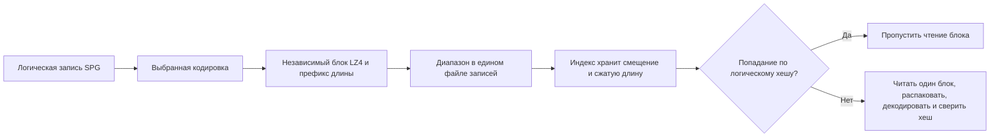
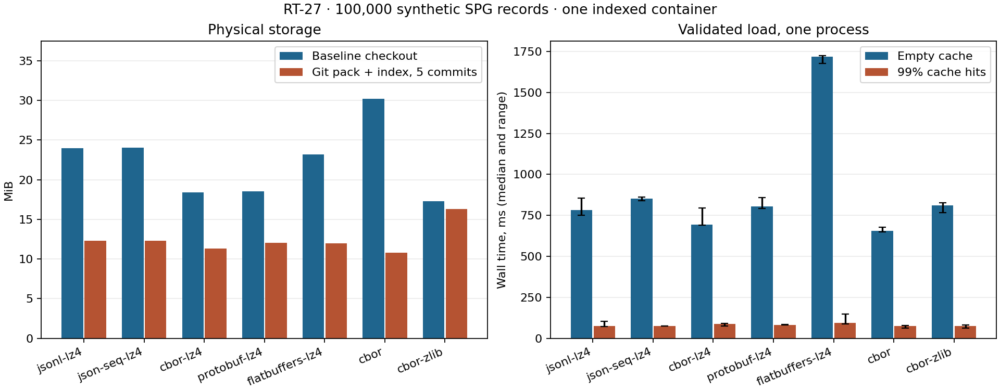

# RT-27 — Дамп SPG с независимым блоком LZ4 на запись

- **Дата** — 26 ноября 2026 года.
- **Статус** — эксперимент на синтетическом корпусе, основание для выбора прототипа.
- **Базовый опыт** — [RT-27 — Сравнение форматов дампа SPG в Git](RT-27-DUMP-FORMAT-COMPARISON.md).

## Вопрос и метод

Меняет ли независимое сжатие каждой записи LZ4 выбор кодировки дампа SPG? Для Git важны и размер файлов в checkout, и объём упакованной истории. Для Toolchain важны время восстановления и доступ к записи по индексу с пропуском записей, уже найденных в кэше.

Сохраняем один контейнер, отдельный индекс по 52 байта на запись, манифест, порядок записей, логическую модель SPG, seed 27001 и историю из пяти коммитов. Основные прогоны проходят одним процессом на 20 000 и 100 000 записях. Сравниваем JSONL, JSON Text Sequences, CBOR, Protobuf и FlatBuffers, сжимая каждую запись каждого из этих пяти вариантов. CBOR без прикладного сжатия и CBOR + zlib уровня 6 повторно запускаем как контрольные варианты на том же стенде. Результаты других несжатых кодеков берём из архивного опыта. Сравнения времени между двумя опытами могут включать межзапусковую вариацию.

Профиль LZ4 использует raw block, режим fast и acceleration 1. Каждый блок имеет четырёхбайтовый little-endian префикс с исходной длиной. Длина сжатой записи уже есть в индексе. Словарь между записями отсутствует. Для стенда допускаются декодированные записи длиной от 1 до 4 096 байт. Это профиль эксперимента. Политика выбора рамки, лимитов и целостности для производственного формата остаётся открытой.



Схема показывает физический слой LZ4 над исходным [циклом чтения по индексу](RT-27-DUMP-FORMAT-COMPARISON.md#сравниваемые-конструкции). При промахе читается один независимый блок. Дополнительный тест распределяет между двумя процессами восемь непересекающихся диапазонов того же файла с заранее загруженным индексом. Шардирование отсутствует.

## Воспроизведение

Используем неизменённый архивный стенд RT-27. Адаптер подставляет функции кодирования и декодирования только для нового запуска. Его SHA-256 и версии библиотек сохраняются в журналах. Замеры времени приводятся как медиана трёх повторов. Системный файловый кэш не сбрасывается. Сырые журналы включают переходы истории, размеры, восстановление из клона, уровни попаданий 0–100%, проверки случайного доступа и три контроля повреждения на профиль.

```sh
fixture=research/toolchain-and-collaboration/RT-27/DUMP-FORMAT-COMPARISON-01
python3 -m venv /tmp/spg-dump-lz4
/tmp/spg-dump-lz4/bin/python -m pip install -r "$fixture/requirements.txt" lz4==4.4.5 matplotlib==3.10.8
export LC_ALL=C PYTHONHASHSEED=0
/tmp/spg-dump-lz4/bin/python -B "$fixture/run_lz4.py" \
  --objects 20000 --repeats 3 --seed 27001 \
  --output /tmp/evidence-lz4-20k.json --ranges-output /tmp/evidence-lz4-single-file.json
/tmp/spg-dump-lz4/bin/python -B "$fixture/run_lz4.py" \
  --objects 100000 --repeats 3 --seed 27001 --output /tmp/evidence-lz4-100k.json
/tmp/spg-dump-lz4/bin/python -B "$fixture/chart.py" \
  /tmp/evidence-lz4-100k.json /tmp/comparison-lz4-100k.png
```

[Адаптер LZ4](DUMP-FORMAT-COMPARISON-01/run_lz4.py) · [Архивный стенд](DUMP-FORMAT-COMPARISON-01/run.py)

## 20 000 записей

Checkout включает файл записей, индекс и манифест первого снимка. Git pack включает файл `.pack` и индекс `.idx` после пяти коммитов и перепаковки. Восстановление — медиана трёх измерений при пустом прикладном кэше.

| Профиль | Checkout, MiB | Git pack, MiB | Восстановление, мс |
|---|---:|---:|---:|
| JSONL + LZ4 | 4,76 | 2,40 | 156,9 |
| JSON Text Sequences + LZ4 | 4,78 | 2,40 | 152,5 |
| CBOR + LZ4 | 3,65 | 2,27 | 125,4 |
| Protobuf + LZ4 | 3,67 | 2,33 | 144,2 |
| FlatBuffers + LZ4 | 4,60 | 2,37 | 308,3 |
| CBOR | 6,01 | 2,15 | 117,9 |
| CBOR + zlib | 3,44 | 3,17 | 161,9 |

### Чтение диапазонов одного файла

Медианы трёх замеров включают создание пула процессов, чтение, декодирование и сверку хешей. Загрузка индекса выполняется до замера. Этот тест измеряет выигрыш от параллельного чтения уже адресованных диапазонов.

| Профиль | 1 процесс, мс | 2 процесса, мс | Ускорение |
|---|---:|---:|---:|
| JSONL + LZ4 | 167,1 | 89,4 | 1,87× |
| JSON Text Sequences + LZ4 | 155,0 | 107,8 | 1,44× |
| CBOR + LZ4 | 133,4 | 106,8 | 1,25× |
| Protobuf + LZ4 | 159,1 | 88,5 | 1,80× |
| FlatBuffers + LZ4 | 309,9 | 174,6 | 1,78× |
| CBOR | 121,5 | 81,0 | 1,50× |
| CBOR + zlib | 159,9 | 101,2 | 1,58× |

[Сырые замеры 20 000 записей](DUMP-FORMAT-COMPARISON-01/evidence-lz4-20k.json) · [Замеры диапазонов](DUMP-FORMAT-COMPARISON-01/evidence-lz4-single-file.json)

## 100 000 записей

В скобках минимум и максимум трёх измерений при пустом прикладном кэше. При 99% попаданий декодируется 1 000 записей.

| Профиль | Checkout, MiB | Git pack, MiB | Восстановление, мс | 99% попаданий, мс |
|---|---:|---:|---:|---:|
| JSONL + LZ4 | 23,95 | 12,32 | 783,6 [750,8–854,0] | 76,2 |
| JSON Text Sequences + LZ4 | 24,05 | 12,33 | 851,6 [840,1–861,5] | 76,0 |
| **CBOR + LZ4** | **18,43** | **11,35** | **694,0 [691,8–796,1]** | 88,3 |
| Protobuf + LZ4 | 18,54 | 12,02 | 804,5 [791,6–858,3] | 82,6 |
| FlatBuffers + LZ4 | 23,17 | 11,99 | 1 717,9 [1 675,8–1 726,1] | 93,4 |
| CBOR | 30,24 | 10,79 | 656,3 [648,5–676,3] | 76,0 |
| CBOR + zlib | 17,31 | 16,33 | 812,2 [765,7–825,9] | 74,7 |



На графике каждый профиль имеет одну колонку для checkout и вторую для Git pack. Справа показаны медианы времени загрузки для пустого и почти полного прикладного кэша. Отрезки показывают диапазон повторов. [Сырые замеры 100 000 записей](DUMP-FORMAT-COMPARISON-01/evidence-lz4-100k.json)

У каждого LZ4-варианта checkout уменьшился на 33–39% относительно его несжатого варианта из базового опыта. Изменение Git pack зависело от кодировки. Protobuf + LZ4 уменьшил pack на 0,5%, у остальных вариантов pack вырос в диапазоне от 1,1% до 7,3%. Оба повторно запущенных контроля воспроизвели архивные коммиты и размеры Git pack на обоих масштабах.

При 99% попаданий CBOR + LZ4 прочитал около 136 KiB записей и 4,96 MiB метаданных. Несжатый CBOR прочитал около 254 KiB записей при практически том же объёме метаданных. При полном попадании все профили прочитали и декодировали ноль байтов записей. При загруженном индексе медианы адресного чтения CBOR + LZ4 в ранней, средней и поздней частях файла составили 6,35, 6,32 и 6,37 мкс.

Все профили воспроизвели корни исходной истории. Стенд восстановил 70 комбинаций «коммит × профиль» из клонов и отклонил 42 случая повреждения манифеста, индекса или данных. В запускаемом стенде использовались CPython 3.12.14, Git 2.52.0, пакет `lz4` 4.4.5 с liblz4 1.9.4. Остальные версии и точные параметры записаны в журналах.

## Выбор для прототипа

- Если **LZ4 обязателен на каждую запись**, первым кандидатом остаётся **CBOR + LZ4 с отдельным индексом**. На обоих размерах корпуса у него наименьшие checkout, Git pack и медиана полного восстановления среди пяти LZ4-профилей.
- Если основная цель — **меньшая история Git и быстрое восстановление одним процессом**, несжатый CBOR остаётся предпочтительным в этом опыте. На 100 000 записях LZ4 уменьшил его checkout на 39%, увеличил Git pack на 5,1% и поднял медиану полного восстановления примерно на 6%.
- Если важен **минимальный checkout**, CBOR + zlib занял 17,31 MiB против 18,43 MiB у CBOR + LZ4. Его Git pack вырос до 16,33 MiB против 11,35 MiB у LZ4. Медиана полного восстановления с LZ4 оказалась на 15% ниже.

## Ограничения

- Синтетическая проекция покрывает скалярное значение, строки и упорядоченные ссылки. Полная модель SPG, реальные распределения размеров, межъязыковая канонизация и эволюция кодеков остаются за пределами опыта.
- Результаты относятся к одной Git-истории, одному профилю Git pack и выбранной реализации raw LZ4 block. Рамки LZ4 Frame, словари, совместное сжатие нескольких записей, режимы LZ4 HC и выборочное хранение коротких записей без сжатия требуют отдельных измерений.
- Время включает распаковку, декодирование и сверку логического хеша. Системный файловый кэш сохраняется. Интервалы min–max описывают три повтора на одном стенде. Изменения размеров упакованной истории измерены для дампа целиком, включая индекс.
- Проверены локальные ссылки, диаграмма PNG и структура Mermaid. Визуальный рендер Mermaid в GitHub отдельно не проверялся.
