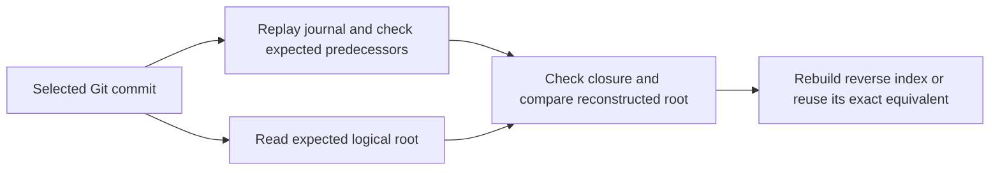

# RT-27 — Restore logical deletion and reverse indexes from Git

Can a clean clone reconstruct a deletion exactly after journal compaction, and can it distinguish an index problem from a graph problem? This fixture covers selected rules in R-STORE-009–012 on baseline `f3162a6e51c9bd043a663b2dfed80968139e2765`. [RT-27 storage requirements](RT-27-SPG-REPOSITORY-STORAGE-FORMAT-REQUIREMENTS.md#4-semantic-and-operational-constraints)

The fixture commits an aggregated journal and a manifest in each revision. The journal contains explicit adds, a replacement bound to the previous content hash, and a deletion bound to the removed content hash. The manifest pins the canonical digest of the entire live map. A reverse index is optional and reconstructible as occurrence pairs of source identity and reference slot. The harness clones with `--no-local --no-checkout`, removes the origin fixture and reads the selected commit's blobs through Git.



| Selected revision | Restore result |
|---|---|
| Initial map | Restores the legacy record and both references to it |
| Journal with replacement and deletion, carrying old index | Restores the new map and rebuilds the stale index |
| Compacted journal, carrying no index | Restores the same new map and rebuilds the missing index |
| Compacted journal, correct root on index with one missing occurrence | Discards the index and rebuilds both occurrences |
| Replacement with deletion omitted | Refuses the changed logical root |
| Deletion leaving the old reference | Refuses the incomplete graph |
| Replacement with the wrong predecessor | Refuses the event |

The compacted revision replaces the five-event journal with two live-record events, keeping the same root. Its tree contains two tracked files. The old revision still restores from Git history. The same-root incomplete index demonstrates why checking only its root header does not prove coverage. The fixture builds the exact projection before admitting any supplied index. It provides no index lookup speedup. [Exact graph, projection and case receipts](JOURNAL-COMPACTION-01/evidence.json)

A candidate separation is to require exact reconstruction of authoritative graph state before publication and allow optional indexes to be discarded and rebuilt. The fixture uses a small explicit graph and assumes the selected commit and manifest are the intended ones. It leaves production encoding, author authorization, large and divergent histories, compaction cost, and bounds on Git history growth open. [Git representation issue](https://github.com/aivibeflow/LLMLang/issues/320)

## Reproduction

Git 2.56.1 and CPython 3.12.14 produced the same receipt with hash seeds 1 and 2. The diagram was checked as Mermaid source.

```bash
fixture=research/toolchain-and-collaboration/RT-27/JOURNAL-COMPACTION-01
LC_ALL=C PYTHONHASHSEED=1 python3 -B "$fixture/run.py" > /tmp/llmlang-rt27-journal.json
cmp "$fixture/evidence.json" /tmp/llmlang-rt27-journal.json
```
