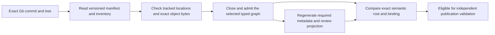

# RT-24/27 canonical logical program representation in Git

A selected Git revision must contain enough exact information to reconstruct the admitted semantic program offline. Object packing, Git object format and readable review output can vary while preserving that program. This candidate specifies a versioned logical envelope and the checks that connect it to one native Git selection. It reconciles five archived Git studies and verifies a small canonical ordering model.

## Candidate representation

A committed manifest binds the logical schema/version, exact selected semantic root, required record inventory, typed semantic references, selection and relation rules, and the metadata reconstruction profile. In the logical inventory, each exact key appears once, the selected root resolves through the inventory, and records use a fixed canonical ordering. Recursive groups refer to admitted local selectors and exact external dependencies. Preserve the selected slots, provider bindings and relation state needed to reconstruct the graph. If an exact source inventory is part of the profile, its paths, grammar, tool versions and external inputs must be independently admitted against the selected tree.

The transport envelope identifies the exact Git object format, tree and tracked record containers. Packed records, stable shards and other candidate layouts map exact record addresses to checked locations. A location map has its own version and exact bytes. It cannot change the semantic root. A generated reverse index can be accepted only if its exact expected content agrees with a version-matched reconstruction. Required reconstruction metadata and program bytes must be present in the Git closure or demonstrably derivable from it. A cache can serve only verified exact records in that closure. Optional accelerators can remain outside the tracked state.



Source files remain reviewable in Git. A configured review projection can show exact selected declarations or binding changes and omit storage-only repacking. Its tracked text or receipt is derived. Publishing a candidate still requires validating complete graph and contract closure. Git itself supplies commit provenance and ordered ancestry, which can differ for the same typed selection. Ordinary Git text merging can propose a tree. It cannot authorize the typed program implied by that tree.

## Checked scope

The small envelope model compares six inventory permutations with two transport layouts and two Git format labels. Each of the 24 cases yields identical logical bytes. Changing one exact record address changes the logical bytes. Duplicate keys and a missing root are refused. The model uses stand-in addresses and labels. It demonstrates the ordering and separation rules, while the native fixtures below use actual Git objects and semantic addresses.

| Archived fixture | Checked evidence |
|---|---|
| [Closed Git representation](RT-27-GIT-CLOSED-REPRESENTATION-2026-11-25.md) | Eight selected states recover offline and four need exact external KV objects. Ten controls refuse unavailable, corrupt, stale or noncanonical inputs. |
| [Profiled typed records](RT-27-SPG-PROFILED-RECORDS-2026-11-25.md) | Two 18-value SPGs restore from offline clones. The four-container profile uses seven tracked files. Exact complete cache hits read and decode zero payload records. |
| [Typed review projection](RT-27-SPG-REVIEW-PROJECTION-2026-11-25.md) | Five revisions preserve checked projection and receipt. Repacking changes six storage paths without changing review text. A provider rebind remains visible. |
| [Commit, tree and semantic root](../RT-24/RT-24-COMMIT-TREE-SEMANTIC-ROOT-MAPPING-2026-11-25.md) | Sixteen native commits distinguish message, physical tree, ordered ancestry and exact program meaning. Corresponding SHA-1 and SHA-256 Git profiles retain the semantic root. |
| [Whole-graph merge gate](RT-27-TEXT-MERGE-GATE-2026-11-25.md) | Git reports 24 clean merge trees. Typed joint validation admits eight and refuses 16. |

A one-file-per-object layout supplies exact reconstruction but exceeds the tracked-path constraint for the studied profile. A Git manifest backed only by an external KV service can carry a lightweight checkout but leaves required offline program bytes missing. Packed or sharded canonical records can satisfy the checked closure, with different cost and merge trade-offs. The logical envelope works across these transport comparisons and gives the import and review layers separate checks.

## Verify and limits

The [checker](GIT-LOGICAL-ENVELOPE-01/check.py) and [ledger](GIT-LOGICAL-ENVELOPE-01/evidence.json) use CPython 3.12.14 and pin five native ledgers at `3fc3ce60b041052470abdb3376f7ad53bc25b113`. The underlying Git version is recorded as 2.52.0. The crosswalk runs with Git 2.56.1 and verifies archived counts without rebuilding the prior repositories. Both hash seeds produce identical outputs.

```bash
fixture=research/toolchain-and-collaboration/RT-27/GIT-LOGICAL-ENVELOPE-01
PYTHONHASHSEED=37 python3 -B "$fixture/check.py" > /tmp/llmlang-git-logical-envelope.json
cmp "$fixture/evidence.json" /tmp/llmlang-git-logical-envelope.json
```

Full source/graph correspondence, production manifest authority, cross-platform paths and the choice of physical container require separate research and approval. This report defines a logical candidate without selecting a storage layout.
