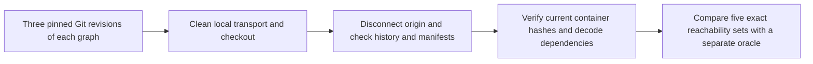
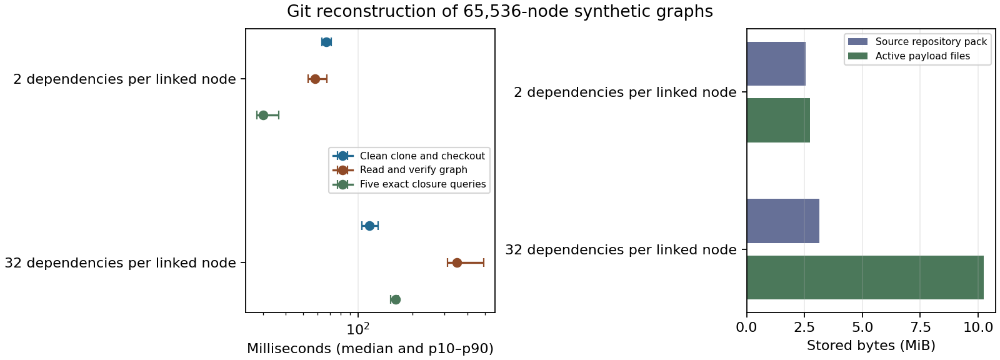

# RT-27 Git reconstruction and traversal of large synthetic graphs

Repository pack size, active checkout volume and graph traversal cost can respond differently to dependency density. This experiment uses two synthetic Git repositories with 65,536 immutable graph nodes each. One graph has two dependencies per node after its initial layer. The other has 32. Both have 1,024 layers of 64 nodes and the same fixed set of query roots. [Earlier Git layouts](RT-27-SHARDED-GIT-HISTORY-2026-11-24.md) · [Storage requirements](RT-27-SPG-REPOSITORY-STORAGE-FORMAT-REQUIREMENTS.md)



The disposable repositories use 128 binary containers, each with 512 nodes, and a manifest of container SHA-256 digests. The first commit stores the full graph. Two following commits change payloads in two containers each and retain the dependency topology. Local Git packs use one thread and compression level 6. The container encoding is a fixture.

The timer separates the non-local Git clone and checkout from current graph decoding and validation. The measured clone uses local file transport with ordinary Git object transfer. After each clone the runner removes its origin, verifies the complete three-commit sequence and checks each historic manifest. The current read validates all container bytes, complete node order and admitted degree and layer relationships. Five measured closure queries on the decoded graph agree with an independently calculated layer-by-layer oracle. Historical graph contents beyond the pinned manifests remain outside the timed validation.

## Results

Seven randomized trial pairs each use fresh checkouts. The controller runs on logical CPU 4 on AMD EPYC 9V74, Linux 6.18.57 and Git 2.56.1. The recorded cgroup counters show zero throttled periods. Timing entries are medians in milliseconds.

| Dependencies per linked node | Edges | Source repository pack, bytes | Current container bytes | Clone and checkout, ms | Read and verify, ms | Five queries, ms |
| --- | ---: | ---: | ---: | ---: | ---: | ---: |
| 2 | 130,944 | 2,673,889 | 2,883,584 | 66.61 | 57.72 | 29.90 |
| 32 | 2,095,104 | 3,292,068 | 10,747,904 | 115.16 | 351.01 | 161.18 |



All 14 clones match the expected current contents and all 70 closure queries agree. The larger profile has roughly 16 times as many edges and its traversals take longer, even though the closure from the final node increases only from 65,160 to 65,441 members. Repeated layer structure compresses well in the Git pack. The measured file sizes and times depend on that structure. Long histories, remote transport, working-set memory, authenticated storage, cycles and representative development repositories remain open. [Raw trials](LARGE-GIT-GRAPH-BENCHMARK-01/evidence/samples.csv) · [Summary](LARGE-GIT-GRAPH-BENCHMARK-01/evidence/summary.json) · [Commit and manifest ledger](LARGE-GIT-GRAPH-BENCHMARK-01/evidence/config.json)

## Reproduction

Use Git 2.56.1, CPython 3.12.14 and Matplotlib 3.10.8 on Linux with cgroup CPU accounting. Choose a CPU within the runner's allowed affinity. The generated histories and their manifest hashes are deterministic under the recorded inputs. Timings vary across runs.

```sh
study=research/toolchain-and-collaboration/RT-27/LARGE-GIT-GRAPH-BENCHMARK-01
build=$(mktemp -d)
LC_ALL=C PYTHONHASHSEED=37 PYTHONDONTWRITEBYTECODE=1 python "$study/measure.py" \
  --cpu 4 --trials 7 --seed 20261125 --output "$build/evidence"
LC_ALL=C MPLBACKEND=Agg MPLCONFIGDIR="$build/plot-cache" python "$study/summarize.py" \
  --evidence-dir "$build/evidence"
```

[Collector](LARGE-GIT-GRAPH-BENCHMARK-01/measure.py) · [Summarizer](LARGE-GIT-GRAPH-BENCHMARK-01/summarize.py)
