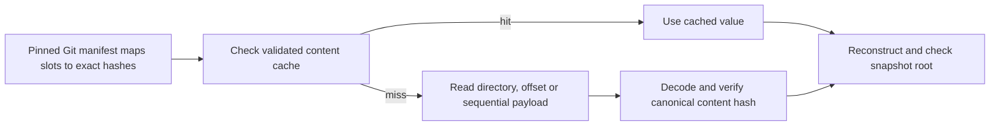

# RT-27 — Cache-first reads with exact Git metadata and indexed containers

All three layouts reconstructed the same snapshot from a clean Git clone. With a fully populated cache, each read only the pinned manifest and decoded no stored payloads. At 50% cache coverage, indexed and ZIP access decoded only the 128 absent objects. A sequential file read and decoded all 256 because it had no per-record address or offset.

## Method

The generated snapshot contains 256 distinct canonical values with short repeated body text and fixed-seed variants. A tracked manifest maps logical slots to semantic content hashes and declares the expected snapshot root. The experiment compares a sequential JSON-lines file, an indexed container with independently compressed records and a ZIP with hash-named members. Each layout aggregates many values into a few working-tree files. Git stores the complete fixture and reconstructs all layouts in a non-local clone that passes `git fsck --full`.

The reader pins metadata against the manifest and index blobs from the exact commit before treating either as authoritative. It resolves slots and checks the content-addressed cache. On a miss, it verifies the decoded canonical value against the selected content hash. A cache-supplied value also has to match its address. The manifest is shared across layouts. When it identifies the entire required state and every cached value matches its address, no container needs to be opened.



## Results

| Layout | Initial hits | Metadata bytes | Payload bytes | Payload decodes |
| --- | ---: | ---: | ---: | ---: |
| indexed | 0 | 40,473 | 30,478 | 256 |
| indexed | 128 | 40,473 | 15,228 | 128 |
| indexed | 256 | 20,342 | 0 | 0 |
| scan | 0 | 20,342 | 69,094 | 256 |
| scan | 128 | 20,342 | 69,094 | 256 |
| scan | 256 | 20,342 | 0 | 0 |
| zip | 0 | 49,824 | 54,286 | 256 |
| zip | 128 | 49,824 | 27,132 | 128 |
| zip | 256 | 20,342 | 0 | 0 |

Counts measure bytes returned to user-space reads. ZIP directory and footer reads count as metadata. Member header and compressed record reads count toward payload access. The counts do not predict disk block traffic or wall-clock cost. The indexed container and its side index occupy 50,609 bytes, the ZIP occupies 83,748 bytes and the sequential file occupies 69,094 bytes, each excluding the shared manifest. Both compressed formats use the pinned zlib release. Reversing the input insertion order produces byte-identical files for every layout.

Changing two manifest slot selections changes the root even when all content addresses exist in the cache. The true Git pin rejects the changed manifest before serving a warm result. A wrong index offset fails metadata matching. Deliberately repinning the bad index still reaches the wrong record and fails the content-address check. A substituted cached value at a valid key also fails. These controls distinguish correct value bytes from correct selection and correct physical location.

## Implementation boundary

The shared manifest makes a fully warm read path independent of the physical container in this fixture. An addressable index or directory matters once some content is absent. The smaller indexed layout trades ZIP interoperability for a separately authenticated offset index. The workload has small acyclic values and a fixed mixed-hit order. Wider SPG objects, parallel access, history delta compression, compaction, dirty worktrees and trusted publication remain open. The reader reconstructs the pinned snapshot on a cache hit and makes no claim about unaccessed payload bytes in a modified checkout.

## Reproduce

Use CPython 3.12.14, zlib 1.3.2 and Git 2.52.0 from the repository root. The runner uses only temporary repositories and places exact physical file digests and read counts in the ledger.

```sh
fixture=research/toolchain-and-collaboration/RT-27/METADATA-FIRST-01
output=$(mktemp)
python3 "$fixture/run.py" --output "$output"
cmp "$fixture/evidence.json" "$output"
python3 "$fixture/chart.py"
```

[Runner](METADATA-FIRST-01/run.py) · [Evidence ledger](METADATA-FIRST-01/evidence.json) · [Repository format requirements](RT-27-SPG-REPOSITORY-STORAGE-FORMAT-REQUIREMENTS.md)
