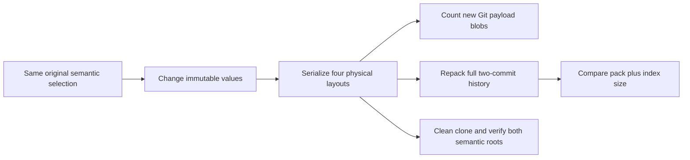

# RT-27 — Git history costs for stable shards and immutable segments

Module shards localized payload changes when the edited values belonged to a few modules. Hash-prefix shards touched all 32 shards on both larger edit rates, even when only four modules changed. Immutable segments wrote the fewest new payload bytes. Their packs could still exceed rewritten layouts, and compaction reduced the active checkout while increasing retained Git history.

## Method

Each of 24 Git repositories stores the same baseline of 10,000 immutable values, with variable text lengths and deterministic fingerprints. A change replaces 1, 100 or 1,000 selections. Each replacement adds a new content address and stops selecting the old one. The balanced placement spreads changes across 32 module buckets where the count permits. The concentrated placement uses four buckets. No layout changes the selected value or semantic root.

| Layout | Physical rule |
| --- | --- |
| Monolith | Rewrite one ordered container with the active selection. |
| Module shards | Group active values by stable module bucket. |
| Hash shards | Group active values by a prefix of their immutable content address. |
| Segments | Keep the baseline segment, append replacement rows and record the old hashes as tombstones. |

The runner measures new payload blob content bytes before packing and actual pack plus index size after the same aggressive Git repack. It pins Git 2.52.0, one pack thread, compression level 6, aggressive window 10 and depth 50. New payload bytes count changed Git blobs. They exclude the logical manifest and do not measure host writes or transfer bytes. Both commits are reconstructed from a clean non-local clone by independently rechecking content addresses, active slots, tombstones and exact roots. All repositories pass `git fsck --full`.



## Results

| Placement | Replacement rate | Layout | Payload blobs changed | New payload bytes | Pack plus index bytes |
| --- | ---: | --- | ---: | ---: | ---: |
| spread | 0.01% | monolith | 1 | 3,483,232 | 876,743 |
| spread | 0.01% | module-shards | 1 | 108,050 | 870,398 |
| spread | 0.01% | hash-shards | 2 | 233,843 | 886,780 |
| spread | 0.01% | segments | 1 | 322 | 876,740 |
| spread | 1% | monolith | 1 | 3,483,970 | 886,284 |
| spread | 1% | module-shards | 32 | 3,483,970 | 883,447 |
| spread | 1% | hash-shards | 32 | 3,483,970 | 900,337 |
| spread | 1% | segments | 1 | 34,779 | 889,374 |
| spread | 10% | monolith | 1 | 3,484,798 | 970,259 |
| spread | 10% | module-shards | 32 | 3,484,798 | 962,364 |
| spread | 10% | hash-shards | 32 | 3,484,798 | 992,636 |
| spread | 10% | segments | 1 | 346,387 | 1,003,165 |
| concentrated | 0.01% | monolith | 1 | 3,483,340 | 876,735 |
| concentrated | 0.01% | module-shards | 1 | 107,229 | 870,382 |
| concentrated | 0.01% | hash-shards | 2 | 218,419 | 886,763 |
| concentrated | 0.01% | segments | 1 | 250 | 876,740 |
| concentrated | 1% | monolith | 1 | 3,484,888 | 886,150 |
| concentrated | 1% | module-shards | 4 | 434,010 | 879,970 |
| concentrated | 1% | hash-shards | 32 | 3,484,888 | 900,468 |
| concentrated | 1% | segments | 1 | 35,123 | 889,248 |
| concentrated | 10% | monolith | 1 | 3,486,364 | 966,199 |
| concentrated | 10% | module-shards | 4 | 435,486 | 958,907 |
| concentrated | 10% | hash-shards | 32 | 3,486,364 | 990,137 |
| concentrated | 10% | segments | 1 | 346,894 | 1,001,958 |

At 1% concentrated change, four module shards produce 434,010 new payload bytes. The same rate spread across all modules produces 3,483,970, and hash shards rewrite approximately 3.48 MB in both cases. Appending segments keeps new payload bytes near 35 KB at that rate. At 10% spread, segments write 346,387 new payload bytes and reach 1,003,165 pack-plus-index bytes, compared with 970,259 bytes for the monolith. The distinct outcomes show how Git deltas can reduce repository growth even when a whole logical container changes.

Compacting the 10% concentrated segment checkout removes the dead rows and drops active payload from 3,830,234 to 3,486,364 bytes. The pack plus index grows from 1,001,958 to 1,092,241 bytes after retaining the compaction commit. A native fetch into the clean clone reconstructs the identical active semantic root after compaction. The ledger records exact commits, roots, manifest sizes and delta counts for all configurations.

## Implementation boundary

Group by module when the actual edit workload has that locality and module placement can stay stable. Hash placement makes old and new versions independently distributed. Immutable segments reduce new payload materialization and require an active membership history and a compaction policy. The comparison covers a variable-size generated fixture, two-commit histories and one compaction. Real SPG reference structure, long history, clone and fetch byte measurements, parallel serialization, checkout timing and production topology remain open.

## Reproduce

Use Git 2.52.0 and CPython 3.12.14 from the repository root. The runner repacks only disposable local repositories. Git author and committer identities and timestamps are fixed in the shared fixture helper.

```sh
fixture=research/toolchain-and-collaboration/RT-27/SHARDED-HISTORY-01
output=$(mktemp)
python3 "$fixture/run.py" --output "$output"
cmp "$fixture/evidence.json" "$output"
python3 "$fixture/chart.py"
```

[Runner](SHARDED-HISTORY-01/run.py) · [Evidence ledger](SHARDED-HISTORY-01/evidence.json) · [Earlier pack benchmark](GIT-BINARY-SPG-STORAGE-EFFICIENCY.md) · [Format requirements](RT-27-SPG-REPOSITORY-STORAGE-FORMAT-REQUIREMENTS.md)
