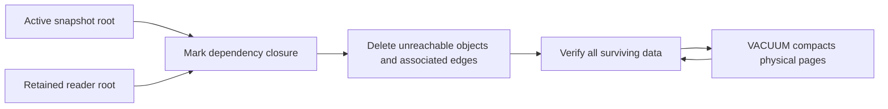
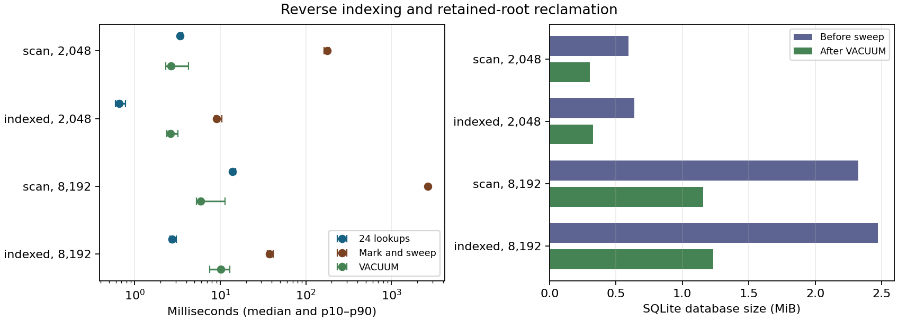

# RT-27 SQLite reverse indexing and retained-root reclamation

An immutable object store needs to preserve objects reachable from every retained root. It also needs to distinguish logical deletion from physical file compaction. This pilot measures a local SQLite storage layout with and without a reverse dependency index. The same graph, retained roots and foreign-key constraints apply to both layouts. [RT-27 storage requirements](RT-27-SPG-REPOSITORY-STORAGE-FORMAT-REQUIREMENTS.md)



The fixture contains 2,048 or 8,192 synthetic objects, each with a 256-byte payload. Objects form four independent dependency groups. A selected active root and a pinned reader root each keep one quarter. The serial transaction populates a temporary mark table from both roots and deletes only unmarked objects. Foreign-key cascades maintain the dependency table. The optional reverse index is on dependency target and source. Each trial checks SQLite's query plan, independently verifies 24 incoming queries, and compares exact retained object bytes and edges before and after compaction.

A read-only control computes the reachability closure from the active root alone. It omits the entire pinned group, 512 objects at the small size and 2,048 at the larger size. The full collector preserves the pinned group and removes exactly half the original objects. The control uses a synthetic database in a temporary directory. Registered roots are stable during each collector invocation.

## Measured results

Ten trials per layout and size run in randomized order with a new local database in a fresh process. The benchmark uses SQLite 3.53.1, rollback-journal mode, full synchronous writes, automatic indexes disabled and 4 KiB pages. It pins logical CPU 4 on AMD EPYC 9V74 with Linux 6.18.57. No cgroup CPU periods were throttled. The table shows medians.

| Layout | Objects | 24 lookups, ms | Mark and sweep, ms | VACUUM, ms | File before sweep / after VACUUM, bytes |
| --- | ---: | ---: | ---: | ---: | ---: |
| Scan | 2,048 | 3.39 | 177.15 | 2.66 | 622,592 / 319,488 |
| Indexed | 2,048 | 0.66 | 9.01 | 2.62 | 667,648 / 344,064 |
| Scan | 8,192 | 13.77 | 2,666.57 | 5.90 | 2,437,120 / 1,212,416 |
| Indexed | 8,192 | 2.73 | 37.55 | 10.14 | 2,592,768 / 1,290,240 |



All 40 databases have matching semantic digests across layouts at the same size. The indexed layout reduces lookup and collection time. Its target-key index provides a search path for finding rows that reference a deleted value. The phase timer includes marking, deletion and commit. It leaves their individual contributions unresolved. Sweeping frees pages but leaves file size unchanged in this fixture. VACUUM reduces the file size and preserves the semantic digest. The larger indexed case adds 155,648 bytes before collection and takes 4.22 ms to build the index. The result applies to this local schema and topology. It leaves concurrent root publication, active reader isolation, power-loss recovery, representative storage and the production layout decision open. [Raw samples](SQLITE-RETENTION-BENCHMARK-01/evidence/samples.csv) · [Summary](SQLITE-RETENTION-BENCHMARK-01/evidence/summary.json) · [Configuration](SQLITE-RETENTION-BENCHMARK-01/evidence/config.json)

## Reproduction

Use CPython 3.12.14 with SQLite 3.53.1 and Matplotlib 3.10.8 on Linux with cgroup CPU accounting. Choose a CPU in the runner's allowed affinity. Fresh timings vary.

```sh
study=research/toolchain-and-collaboration/RT-27/SQLITE-RETENTION-BENCHMARK-01
build=$(mktemp -d)
LC_ALL=C PYTHONHASHSEED=37 PYTHONDONTWRITEBYTECODE=1 python "$study/measure.py" \
  --cpu 4 --trials 10 --seed 20261125 --output "$build/evidence"
LC_ALL=C MPLBACKEND=Agg MPLCONFIGDIR="$build/plot-cache" python "$study/summarize.py" \
  --evidence-dir "$build/evidence"
```

[Collector](SQLITE-RETENTION-BENCHMARK-01/measure.py) · [Summarizer](SQLITE-RETENTION-BENCHMARK-01/summarize.py)
