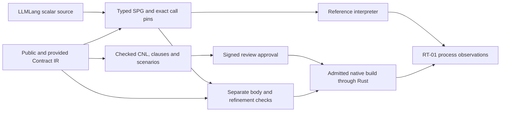

# LLMLang scalar MVP

This release implements the Calculator path in the [MVP plan](../../PLAN.md#mvp-implementation-plan) and the scalar profile of [Contract IR](../../PLAN.md#contract-ir-and-controlled-natural-language-rendering). The Stage 0 compiler is written in Rust and translates typed scalar SPG to standalone Rust. A separate Python frontend checks that Stage 0 reconstructs the same canonical graph. The Python interpreter and the resulting Linux x86-64 executable expose the same results, errors and process behavior on the applicable RT-01 cases.



## Reproduce from a checkout

The tested target is `x86_64-unknown-linux-gnu`. Use Python 3.12, Rust 1.85.1 with Cargo and a host linker, Boogie 3.5.5 with .NET 8, Z3 4.13.3, OpenSSL 3, and Lean 4.36.0. The [CI workflow](../../.github/workflows/llmlang-mvp.yml) prepares the toolchains. Cargo fetches the lockfile dependencies once. The Stage 0 build then runs offline.

```sh
rustup toolchain install 1.85.1 --profile minimal
rustup override set 1.85.1
cargo fetch --locked --manifest-path tools/llmlang_mvp/stage0/Cargo.toml
cargo build --offline --locked --manifest-path tools/llmlang_mvp/stage0/Cargo.toml
cargo test --offline --locked --manifest-path tools/llmlang_mvp/stage0/Cargo.toml

python -B -m tools.llmlang_mvp show-spg
python -B -m tools.llmlang_mvp export-contract-ir
python -B -m tools.llmlang_mvp review
python -B -m tools.llmlang_mvp check
python -B -m tools.llmlang_mvp.controls
python -B -m tools.llmlang_mvp.conformance --report /tmp/llmlang-conformance.json
lean tools/llmlang_mvp/ScalarChecks.lean
```

The RT-01 command creates a temporary **test** signing identity and builds Calculator, Hello and Echo. The synthetic approval exercises the signing protocol. Its report records exact input and output bytes as hex, exit statuses, tool versions, input hashes, and the repeated SPG reconstruction hash. Hello and Echo exercise the host runtime adapters. For Calculator, the runtime takes one record terminated by LF or EOF and separates its three tokens with spaces, tabs or carriage returns. RT-01 leaves tokens split across multiple records and trailing records outside the acceptance corpus.

## Review and build Calculator

Set up a local reviewer key and trusted policy. In a shared deployment, the build operator provisions the policy and the designated reviewer holds the private key.

```sh
review_dir=$(mktemp -d)
openssl genpkey -algorithm ED25519 -out "$review_dir/reviewer.pem"
openssl pkey -in "$review_dir/reviewer.pem" -pubout -out "$review_dir/reviewer.pub.pem"
key_id=$(python -B -m tools.llmlang_mvp review-key-id "$review_dir/reviewer.pub.pem")
printf '{ "schema": "llmlang-review-policy/v1", "reviewer": "Calculator reviewer", "public_key": "reviewer.pub.pem", "public_key_id": "%s" }\n' \
  "$key_id" > "$review_dir/policy.json"

python -B -m tools.llmlang_mvp review > "$review_dir/packet.txt"
cat "$review_dir/packet.txt"
```

After inspecting the controlled prose, clause origins and scenarios, approve the displayed revision and build it.

```sh
packet=$(sed -n 's/^Review packet: //p' "$review_dir/packet.txt")
python -B -m tools.llmlang_mvp approve-review --packet "$packet" \
  --reviewer "Calculator reviewer" --signing-key "$review_dir/reviewer.pem" \
  -o "$review_dir/receipt.json"
python -B -m tools.llmlang_mvp build --review-receipt "$review_dir/receipt.json" \
  --review-policy "$review_dir/policy.json" -o "$review_dir/calculator"
printf '%s\n' '-7 / 2' | "$review_dir/calculator"
```

The final command prints `-3`. The receipt signs the packet digest, reviewer identity and decision under the policy's Ed25519 key. The packet pins the exact source and Contract IR bytes, SPG, scenario inputs and checked CNL. The build checks scenario results and signature, then obtains fresh Boogie and Z3 results for body conformance and public refinement. A tool error, unknown proof outcome, or stale approval prevents artifact emission. Use `check` for the exact binding manifest, solver verdicts and source or contract confirmation of reported counterexamples.

Global tool options go before the subcommand. Use `--source`, `--contracts` or `--scenarios` for alternate inputs, `--stage0` for a prepared compiler executable, and `--boogie` and `--z3` for verification paths. Use `--previous-contracts PATH` to include a semantic change report. Pass the same review inputs to `review`, `approve-review` and `build`.

## Supported profiles

- The source and executable profile covers `Bool`, `I64`, checked arithmetic, typed functions, local bindings, branching, explicit error outcomes and acyclic direct calls. Signed division truncates toward zero. Source expressions evaluate left to right. Each call targets a specific `ImplHash`; verification discharges exact public call requirements and verifies each provider separately.
- The scalar Contract IR covers typed input domains and success or error predicates. Predicate arithmetic uses mathematical integers and a totalized quotient. The [Contract IR specification](CONTRACT-IR.md) describes the typed wire format, canonical identity, controlled rendering and evidence boundaries.
- The [bounded trace profile](TRACE-PROFILE.md) checks supported clauses against supplied finite observations. Calculator admission uses scalar function proofs and authenticated review. Native I/O sits at the RT-01 conformance boundary.
- The Lean addition theorem covers its explicit reference model. The Boogie translation, Stage 0 and Rust compiler remain part of the trust boundary. The source confirmation of a failing solver obligation does not certify the general translator. Self-hosting and additional source and native ABI profiles remain later roadmap work.

See the [release record](RELEASE.md) for the acceptance evidence and the Contract IR family coverage.
