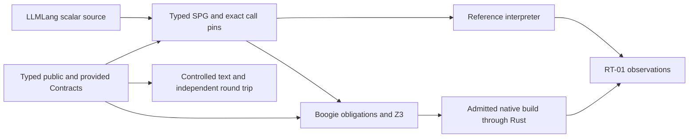

# LLMLang scalar MVP

This workstream implements the first scalar Calculator slice in the [MVP plan](../../PLAN.md#mvp-implementation-plan) and the scalar stage of the [Contract IR plan](../../PLAN.md#contract-ir-and-controlled-natural-language-rendering). The source frontend accepts a restricted Python-like syntax and lowers it to typed LLMLang SPG. Python provides the reference interpreter and orchestration. The prototype compiler emits Rust for the same graph. The syntax and storage formats are provisional.



The example uses four functions over `I64` with distinct overflow and division-by-zero outcomes. The host adapters handle CLI input and output. Boogie checks the provided Contract against the exact function body and separately checks refinement of the public Contract. The Rust build command requires both checks to pass. The interpreter is available for inspection and comparison before verification.

## Reproduction

Run from repository root with Python 3.12, Rust 1.85.1, Boogie 3.5.5, Z3 4.13.3, and Lean 4.36.0 on Linux x86-64. The [CI workflow](../../.github/workflows/llmlang-mvp.yml) installs these tools or their pinned packages.

```sh
python -B -m tools.llmlang_mvp show-spg
python -B -m tools.llmlang_mvp review
python -B -m tools.llmlang_mvp check
python -B -m tools.llmlang_mvp build -o /tmp/llmlang-calculator
printf '%s\n' '-7 / 2' | /tmp/llmlang-calculator
python -B -m tools.llmlang_mvp.controls
python -B -m tools.llmlang_mvp.conformance
lean tools/llmlang_mvp/ScalarChecks.lean
```

Use `--source` and `--contracts` before the subcommand to select alternate files. Use `--boogie` and `--z3` to select executable paths. The review output identifies the semantic snapshot, exact provided and public Contracts and the selected `ImplHash`. An independently parsed controlled rendering must reconstruct the normalized Contract before the output is emitted.

To record a local approval, inspect the controlled text and pass its displayed packet identifier to `approve-review`:

```sh
python -B -m tools.llmlang_mvp approve-review --packet sha256:REPLACE_WITH_DISPLAYED_DIGEST --reviewer 'Reviewer name' -o /tmp/llmlang-review.json
python -B -m tools.llmlang_mvp build --review-receipt /tmp/llmlang-review.json -o /tmp/llmlang-calculator
```

The supplied receipt must match the currently rendered packet. This local acknowledgement uses a self-declared reviewer name. Verifier evidence is computed separately for every build.

## Coverage and limitations

- The executable and Contract IR profiles cover scalar values, checked arithmetic, local bindings, branching, and acyclic direct calls. Contract expressions use mathematical integer arithmetic and a totalized quotient. Outcome guards define when division errors and arithmetic overflow are allowed.
- The verification evidence is generated for this scalar model. The initial trust boundary includes the Python translation and Boogie + Z3. The independent Lean addition theorem checks its explicit reference model. Establishing a general correspondence between the source, Boogie obligations, and Rust artifacts is separate work.
- RT-01 compares process observations for Calculator, Hello and Echo. Hello and Echo exercise host runtime adapters. The native runtime and I/O remain outside the proved scalar function claims.
- The controlled renderer covers the scalar grammar. Authenticated or signed approvals, scenario and clause-level provenance in the review packet, the other Contract IR profiles, and self-hosting remain in the full roadmap.
