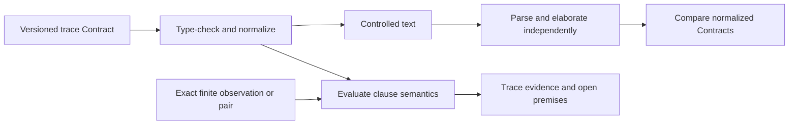

# Bounded trace Contract IR

The `llmlang-trace-contract/v1` profile expresses finite observation clauses from [PLAN.md §1.3](../../PLAN.md#contract-ir-and-controlled-natural-language-rendering) that need state, transitions, effects or pairs of observations. The executable checker compares supplied observations with the clause model. The scalar profile supplies typed input and outcome predicates, checked machine arithmetic and the verification route for Calculator admission. [Scalar Contract IR](CONTRACT-IR.md)



The CNL comparison checks structural fidelity. The observation checker evaluates the Contract against the exact supplied sequence and state records. A `CHECKED` result applies to those observations. Establishing that an implementation produced an authentic and complete trace requires separate evidence.

## Dispatch and typed vocabulary

Run the commands from a repository checkout with Python 3.12.

```sh
example=tools/llmlang_mvp/trace_examples
python -B -m tools.llmlang_mvp.contract_profiles render "$example/withdrawal.contract.json"
python -B -m tools.llmlang_mvp.contract_profiles check "$example/withdrawal.contract.json" "$example/withdrawal-failure.trace.json"
python -B -m unittest tools.llmlang_mvp.test_contract_profiles
```

Use `parse PATH` to parse controlled text into normalized JSON. Use `check CONTRACT TRACE --reference TRACE` for a paired observation. The scalar CLI and trace CLI require their own schema at the input boundary. [Trace CLI implementation](contract_profiles.py)

The Contract object has `schema`, a `state` field-to-type map, an `events` map from event names to field-to-type maps and a nonempty `clauses` list. A clause has a distinct identifier in `id`, a `kind` and the fields specific to that kind. Identifiers use ASCII letters, digits and underscores with a letter or underscore first. `Bool` is a Boolean. `I64` is a signed 64-bit integer. `Symbol` is an identifier. `Hash` is `sha256:` followed by 64 lowercase hexadecimal digits. Each declared event occurrence carries exactly its typed fields.

An observation uses schema `llmlang-observation-trace/v1`. Its `subject` identifies the claimed implementation or model. The `pre` and `post` records use the full state vocabulary. The ordered `events` list contains objects with `name`, `tick` and `fields`. Ticks are nonnegative I64 values in nondecreasing order. List order breaks ties. A complete trace has `complete: true` and an `outcome` of `success`, `error`, `cancelled` or `partial`. A prefix has `complete: false` and a null outcome. Here `post` denotes its last recorded state. `partial` denotes a terminal partial-completion outcome.

Normalization sorts maps, set-valued clause fields, transition tables, and clauses by identifier. Event occurrence order remains observable. The Contract hash is SHA-256 over ASCII `llmlang-trace-contract/v1`, a zero byte and compact sorted-key JSON of the normalized Contract. Trace and evidence identities use their corresponding domains. Clause identifiers participate in identity. Source provenance and signatures belong in records linked by identity. Unsupported schema versions, unknown fields, unresolved clause references and incompatible types fail validation. Each compatible revision retains the v1 meaning and identity rules.

The CNL header fixes the presentation version. State fields and event fields are declared with explicit types. Each clause starts with `Clause IDENTIFIER.` followed by a kind-specific sentence. Fixed phrases and explicit separators distinguish operands, lists, transitions and scope. The independent parser reads those productions and type-checks them against the declared vocabulary. The checked renderer compares its result with normalized input before returning the text. Each clause below has both a rendering template and an independently matched parser production. [Grammar and templates](contract_profiles.py)

## Clause coverage

| Family and IR kind | Meaning on a supplied observation | Bound on the evidence |
| --- | --- | --- |
| Boundary invariant, `invariant(field)` | The named I64 is nonnegative in the initial and final state. | The trace records two state snapshots. Inductive invariants, transition-state invariants and algebraic laws require other profiles. |
| Frame, `frame(fields)` | Every state field outside the declared write set has equal pre and post values. | Requires completion. It observes final state equality, so transient writes and read sets lie outside the claim. |
| Effects, `effects(events)` | Each event belongs to the allowed alphabet. | A protocol can require or order occurrences. The trace vocabulary determines which effects are observable. |
| Ownership, `ownership(acquire, release, field)` | Each acquired symbol is fresh in this trace and is released once after acquisition. Every release has a live matching acquisition. | Completion closes the live set. Symbol lifetimes, borrowing, alias analysis and allocator behavior need richer observations. |
| Failure atomicity, `atomicity(outcomes, fields, events)` | For a selected nonsuccess outcome, preserve the named state fields and allow only the listed events. | Requires a complete observation. Scope is the declared state fields, selected outcomes and observed effects. |
| Termination evidence, `decreases(event, field)` | The I64 observations at this event form a strictly decreasing nonnegative rank sequence. | A finite sample checks recorded visits. It supplies neither inductiveness nor a universal termination claim. |
| Protocol, `protocol(initial, terminal, transitions)` | Starting at the initial state, consume events in order by unique state and event transitions. The final state must be terminal. | Prefixes can establish an illegal transition. Completion is required to assess the terminal set. |
| Timed response, `deadline(trigger, response, ticks)` | A trigger requires a strictly later response within the inclusive bound. A single response can satisfy several preceding triggers. Events later in the sequence may share the trigger tick. | A prefix with an outstanding deadline remains unknown until a response or a later timestamp proves the deadline missed. A complete trace with an outstanding trigger violates the clause. Tick conversion, fairness and scheduling need separate models. |
| Authority, `authority(event, field, allowed)` | Each selected event carries an allowed principal in its typed Symbol field. | The observed principal and policy-provisioning boundary are outside the checker. Delegation and revocation require a different profile. |
| Budget, `budget(event, maximum)` | The count of matching events stays within the bound. | The unit is event occurrences. Mapping events to peak usage, physical time or native cost requires separate evidence. |
| Paired observation, `comparison(reference_subject, inputs, outputs)` | Two complete observations with the same named pre-state inputs have equal selected post-state outputs, outcome and exact ordered events including ticks. | Pins the reference subject and checks the supplied pair. Shared-input or reference mismatch yields `UNKNOWN`. This supports bounded equivalence and, with an explicit public projection and public event alphabet, bounded information-flow observations. Universal relational claims require wider coverage. |
| Modular binding, `binding(event, implementation, required, public, provided)` | Each call event carries exactly the named implementation and three Contract references in typed Hash fields. | Evidence concerns observed pin preservation. Scalar verification separately checks applicable actual call preconditions, body conformance and public refinement. |
| Foreign premise, `assumption(premise)` | Records an open proposition by exact digest. | Yields `CONDITIONAL`. Closing a premise requires a separate policy and evidence route. |

Each evaluated clause reports its own status. `VIOLATED` takes precedence, followed by `CONDITIONAL`, then `UNKNOWN`, then `CHECKED`. A prefix can yield a violation or leave obligations open. Empty occurrence sets make event-universal checks vacuously true on a complete trace. Use a protocol or deadline with a suitable trigger to express required occurrences. The report places the Contract hash, trace hash, optional reference trace hash, subject and checker source SHA-256 under one evidence identity. Parser errors report `UNSUPPORTED`. I/O failures report `ERROR`. Admission of executable artifacts uses the scalar verification and signed-review route.

## Reproducible checks

The withdrawal example models the failure-state preservation slice of [CF-006](../../research/formal-verification/CONTRACT-FORMALIZATION-CORPUS/cases/CF-006-bank-withdrawal.md). Its observation is the corpus case of requesting 101 from a balance of 100, using the fixture's I64 state and empty event vocabulary. The subject identifies a synthetic fixture. Mutating the final balance reproduces the corpus MUT-06 failure. The case's success equivalence and subtraction requirements use a wider state-transition model.

The test suite projects the exact 0–3 resource enumeration and failure mutation of [POB-006](../../research/formal-verification/PROOF-OBLIGATION-BENCHMARK/cases/POB-006.json) into typed acquire and release events and compares the verdicts with the existing bounded oracle. Additional synthetic fixtures check the other supported forms, deterministic identity, CNL round trips, deadline and cleanup boundaries, exact references, malformed input, an open premise and a missing comparison. [Executable fixtures](test_contract_profiles.py)
